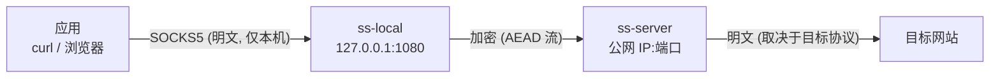

---
Title | Tools Networks Proxy shadowsocks
-- | --
Created @ | `2019-06-29T08:35:42Z`
Updated @| `2026-11-26T10:28:08Z`
Labels | ``
Edit @| [here](https://github.com/junxnone/linux/issues/67)

---
# ShadowSocks

Shadowsocks 是一个基于 SOCKS5 的**加密代理**：本地运行一个客户端（`ss-local`），在本机监听 SOCKS5 端口；远端运行服务端（`ss-server`）。应用把流量交给本地客户端，客户端把它加密后发给服务端，服务端解密后再访问目标并把响应原路带回。它协议简单、资源占用低，常用来在 Linux 上给命令行工具或整台机器提供一个经过加密中继的出口。上层概览与各类代理的对比见 [Proxy](0080_Tools_Networks_Proxy)，另一款功能更丰富的同类工具见 [V2Ray](0066_Tools_Networks_Proxy_V2Ray)。

## 版本与实现

Shadowsocks 最早由 clowwindy 开发，原始的 Python 版本后来停止了维护，现在社区有多个实现：

Name | Description
-- | --
shadowsocks (Python) | 最早的版本；`pip install shadowsocks` 装到的是旧版 2.8.2，GitHub 的 `master` 分支是 3.0.0，需要从源码安装（见下）
shadowsocks-libev | C 语言实现，轻量，适合路由器和小内存机器，Debian/Ubuntu 可以直接 `apt install shadowsocks-libev`
shadowsocks-rust | Rust 实现，功能和协议更新较快，支持较新的协议规范
shadowsocks-go 等 | 其他语言实现

表中第一列是实现名，第二列说明语言和特点。新部署建议优先选 shadowsocks-libev 或 shadowsocks-rust，它们仍在维护，且支持较安全的 AEAD 加密方式；原始 Python 版仅作了解。

## 工作方式

下图展示一次请求从应用到目标网站的路径，以及哪一段是加密的：



图中：

- **应用 → ss-local**：应用按 SOCKS5 协议连接本机的 1080 端口，这一段只在本机回环地址上，不经过网络。
- **ss-local → ss-server**：两者之间用密码派生的密钥加密传输，是整条链路里被保护的部分，中间的网络设备看不到真实访问的目标和内容。
- **ss-server → 目标**：服务端解密后以自己的 IP 访问目标站点；这一段是否加密取决于目标协议（HTTPS 则仍是加密的）。
- 关键结论：Shadowsocks 保护的是"本机到服务端"这一段；它不是匿名网络，服务端能看到你访问了哪些目标。

## 加密方式

`method` 决定数据怎么加密，新旧两类的差别很大：

类型 | 示例 | 说明
-- | -- | --
流加密（Stream cipher） | aes-256-cfb、rc4-md5 | 老式方式，没有完整性校验，容易受到重放和主动探测的攻击，已不推荐
AEAD | chacha20-ietf-poly1305、aes-256-gcm、aes-128-gcm | 带认证的加密，能发现数据被篡改并拒绝，推荐使用
2022 版 AEAD | 2022-blake3-aes-256-gcm 等 | 较新的协议规范，改进了重放防护和密钥处理，需要客户端和服务端的实现都支持

表中第一列是类型，第二列是典型的 `method` 取值，第三列是特点。选择建议：普通 x86 服务器用 `aes-256-gcm`（有 AES 硬件加速）；没有 AES 指令的 ARM/低端设备用 `chacha20-ietf-poly1305`。客户端与服务端的 `method` 和 `password` 必须完全一致。

## Install

**Python 版**

```
pip install git+https://github.com/shadowsocks/shadowsocks.git@master
```
> 此命令会安装 3.0.0，`pip install shadowsocks` 会安装 2.8.2，是被迫停止维护的版本

**shadowsocks-libev（Debian / Ubuntu）**

```
sudo apt update
sudo apt install shadowsocks-libev
```
> 软件源里的版本可能偏旧；需要新版本时可用下面的源码编译。

## Build from source -  shadowsocks-libev
```
# Installation of basic build dependencies
## Debian / Ubuntu
sudo apt-get install --no-install-recommends gettext build-essential autoconf \
libtool  libpcre3-dev asciidoc xmlto libev-dev libc-ares-dev automake \
libmbedtls-dev libsodium-dev

# Installation of libsodium
export LIBSODIUM_VER=1.0.16
wget https://download.libsodium.org/libsodium/releases/libsodium-$LIBSODIUM_VER.tar.gz
tar xvf libsodium-$LIBSODIUM_VER.tar.gz
pushd libsodium-$LIBSODIUM_VER
./configure --prefix=/usr && make
sudo make install
popd
sudo ldconfig

# Installation of MbedTLS
export MBEDTLS_VER=2.6.0
wget https://tls.mbed.org/download/mbedtls-$MBEDTLS_VER-gpl.tgz
tar xvf mbedtls-$MBEDTLS_VER-gpl.tgz
pushd mbedtls-$MBEDTLS_VER
make SHARED=1 CFLAGS="-O2 -fPIC"
sudo make DESTDIR=/usr install
popd
sudo ldconfig

# Start building
./autogen.sh && ./configure && make
sudo make install
```

这是 2019 年前后的写法，libsodium 和 MbedTLS 的版本号（1.0.16、2.6.0）是当时的版本，现在可以换成较新的版本。其中 libsodium 提供 AEAD 需要的 ChaCha20-Poly1305 等算法，MbedTLS 提供 AES-GCM 等算法。

## 配置与运行

服务端和客户端使用同样结构的 JSON 配置：

**服务端 `/etc/shadowsocks-libev/config.json`**

```json
{
  "server": "0.0.0.0",
  "server_port": 8388,
  "password": "请换成足够长的随机密码",
  "method": "chacha20-ietf-poly1305",
  "timeout": 300,
  "mode": "tcp_and_udp"
}
```

**客户端 `config.json`**

```json
{
  "server": "服务端 IP 或域名",
  "server_port": 8388,
  "local_address": "127.0.0.1",
  "local_port": 1080,
  "password": "与服务端一致",
  "method": "chacha20-ietf-poly1305",
  "timeout": 300
}
```

主要字段的含义：

字段 | 含义
-- | --
server | 服务端监听地址（服务端写 `0.0.0.0` 表示所有网卡）；客户端里是要连接的服务端地址
server_port | 服务端端口，需要在防火墙/安全组中放行
local_address / local_port | 客户端本地 SOCKS5 监听地址和端口，一般用 `127.0.0.1:1080`；如果要给局域网内其他机器共享才改成 `0.0.0.0`，但要注意安全
password | 共享密码，客户端服务端必须一致，应使用足够长的随机串
method | 加密方式，必须两端一致
timeout | 空闲连接超时时间，单位秒
mode | `tcp_only` / `udp_only` / `tcp_and_udp`，是否转发 UDP

表中第一列是字段名，第二列是含义。运行：

```
ss-server -c /etc/shadowsocks-libev/config.json     # 服务端
ss-local  -c ./config.json                          # 客户端
```

服务端也可以用 systemd 管理：`sudo systemctl enable --now shadowsocks-libev`（apt 安装的包带有对应服务）。

## 验证

客户端启动后，确认本地端口在监听，再用 SOCKS5 访问一个外部地址：

```
ss -lntp | grep 1080
curl -x socks5h://127.0.0.1:1080 https://example.com -I
```

`socks5h` 表示域名由代理端解析。让命令行工具走这个代理、或者用 Privoxy 把它转成 HTTP 代理供只认 HTTP 代理的程序使用，见 [Proxy](0080_Tools_Networks_Proxy) 里的相应章节。

## 插件

Shadowsocks 定义了插件接口（SIP003），可以在加密传输之外再套一层传输伪装，例如 v2ray-plugin（WebSocket + TLS）、simple-obfs（HTTP/TLS 伪装，已停止维护）。使用插件时，客户端和服务端都要装同样的插件，并在配置里增加 `plugin` 和 `plugin_opts` 字段。

## Error

```
aead.c:274: undefined reference to `crypto_aead_xchacha20poly1305_ietf_decrypt'
ss_local-aead.o: In function `cipher_aead_encrypt':
```

**原因**：编译 shadowsocks-libev 时链接到了系统里旧版本的 libsodium（缺少 `xchacha20poly1305` 相关函数），而不是刚编译安装的新版本。

**Solution**
删除其他 libsodium library，只留下新编译安装的那个
> in my case
```
find /usr/lib/x86_64-linux-gnu/ -name libsodium.*|xargs sudo rm
```

注意这条命令会把系统包管理器安装的 libsodium 文件一并删掉，可能影响依赖它的其他软件；更稳妥的做法是先用 `ldconfig -p | grep sodium` 看有哪些版本，再决定删除或卸载旧包（`sudo apt remove libsodium23` 之类，包名以系统为准），之后重新执行 `sudo ldconfig` 并重新编译。

## 使用须知

- 只在符合所在网络管理规定和当地法律法规的前提下使用。
- 密码是整条链路的唯一凭据，应使用足够长的随机串，并避免提交到公开仓库。
- 不要再使用旧的流加密方式（如 rc4-md5、aes-*-cfb）。

## 相关文章

**协议与组成部分**

- 总览：[Protocol](0182_Tools_Networks_Proxy_Protocol)、[Transport](0181_Tools_Networks_Proxy_Transport)、[Comparison](0180_Tools_Networks_Proxy_Comparison)
- 代理协议：[VMess](0142_Tools_Networks_Proxy_Protocol_VMess)、[VLESS](0143_Tools_Networks_Proxy_Protocol_VLESS)、[Shadowsocks](0144_Tools_Networks_Proxy_Protocol_Shadowsocks)、[Trojan](0145_Tools_Networks_Proxy_Protocol_Trojan)、[Socks](0146_Tools_Networks_Proxy_Protocol_Socks)、[HTTP](0147_Tools_Networks_Proxy_Protocol_HTTP)、[MTProto](0148_Tools_Networks_Proxy_Protocol_MTProto)、[WireGuard](0152_Tools_Networks_Proxy_Protocol_WireGuard)
- 内置处理器：[Freedom](0149_Tools_Networks_Proxy_Protocol_Freedom)、[Blackhole](0150_Tools_Networks_Proxy_Protocol_Blackhole)、[DokodemoDoor](0151_Tools_Networks_Proxy_Protocol_DokodemoDoor)、[Loopback](0153_Tools_Networks_Proxy_Protocol_Loopback)
- 传输：[TCP](0154_Tools_Networks_Proxy_Transport_TCP)、[WebSocket](0155_Tools_Networks_Proxy_Transport_WebSocket)、[HTTP2](0156_Tools_Networks_Proxy_Transport_HTTP2)、[gRPC](0157_Tools_Networks_Proxy_Transport_gRPC)、[mKCP](0158_Tools_Networks_Proxy_Transport_mKCP)、[QUIC](0159_Tools_Networks_Proxy_Transport_QUIC)、[DomainSocket](0160_Tools_Networks_Proxy_Transport_DomainSocket)
- 安全层：[TLS](0161_Tools_Networks_Proxy_Security_TLS)、[XTLS](0162_Tools_Networks_Proxy_Security_XTLS)、[Reality](0163_Tools_Networks_Proxy_Security_Reality)

**V2Ray 功能模块与部署**

- 功能模块：[Routing](0164_Tools_Networks_Proxy_V2Ray_Routing)、[DNS](0165_Tools_Networks_Proxy_V2Ray_DNS)、[Sniffing](0166_Tools_Networks_Proxy_V2Ray_Sniffing)、[Mux](0167_Tools_Networks_Proxy_V2Ray_Mux)、[Policy](0168_Tools_Networks_Proxy_V2Ray_Policy)、[API](0169_Tools_Networks_Proxy_V2Ray_API)
- 部署与使用：[Transparent](0170_Tools_Networks_Proxy_V2Ray_Transparent)、[Systemd](0171_Tools_Networks_Proxy_V2Ray_Systemd)、[Nginx](0172_Tools_Networks_Proxy_V2Ray_Nginx)、[Client](0173_Tools_Networks_Proxy_V2Ray_Client)、[Troubleshooting](0174_Tools_Networks_Proxy_V2Ray_Troubleshooting)

**工具**

- [shadowsocks](0067_Tools_Networks_Proxy_shadowsocks)、[V2Ray](0066_Tools_Networks_Proxy_V2Ray)、[Xray](0175_Tools_Networks_Proxy_Xray)、[sing-box](0176_Tools_Networks_Proxy_sing_box)、[Clash](0177_Tools_Networks_Proxy_Clash)、[Hysteria](0178_Tools_Networks_Proxy_Hysteria)、[TUIC](0179_Tools_Networks_Proxy_TUIC)
- [Privoxy](0139_Tools_Networks_Proxy_Privoxy)、[proxychains](0140_Tools_Networks_Proxy_proxychains)、[Squid](0141_Tools_Networks_Proxy_Squid)、[dev-sidecar](0138_Tools_Networks_Proxy_dev_sidecar)

## Reference

- [shadowsocks readme](https://github.com/shadowsocks/shadowsocks/tree/master#install)
- [ShadowsocksR服务端伪装成 正常网站流量，以更好的欺骗流量匹配](https://doubibackup.com/hi10k-7p-5.html)
- [shadowsocks-libev - Github](https://github.com/shadowsocks/shadowsocks-libev)
- [shadowsocks-rust - Github](https://github.com/shadowsocks/shadowsocks-rust)
- [Shadowsocks 官方网站与 SIP 规范](https://shadowsocks.org/)


