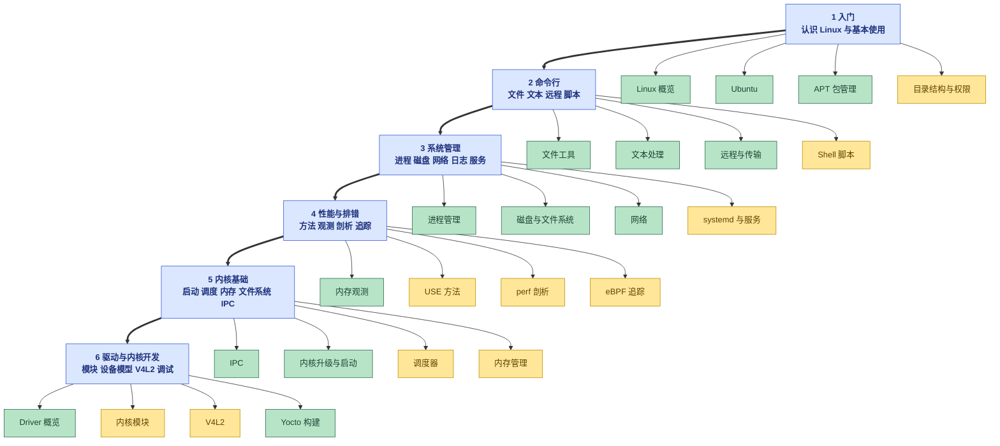
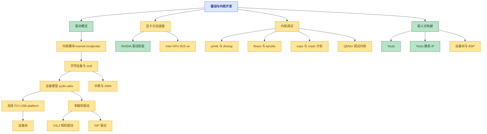

---
Title | Linux RoadMap
-- | --
Created @ | `2024-06-21T18:04:04Z`
Updated @| `2026-11-27T01:53:26Z`
Labels | ``
Edit @| [here](https://github.com/junxnone/linux/issues/130)

---
# Linux RoadMap

从入门到精通的 Linux 学习路线图。用节点图表示「一路深入」的学习顺序：从上到下越来越深，同一层的节点是并列的主题。

图例：

- 绿色节点：本站已有文章，点击可以跳转 (见下面关于点击的说明)
- 黄色节点：本站还没有的文章，先不链接，列在文末的「待新增」里
- 实线箭头：建议的学习顺序；虚线箭头：相关或可选的衔接

图中：左边是已有文章的颜色，右边是待新增的颜色，下面所有图都沿用这套配色。

> 关于点击：绿色节点带有 `click` 链接，在支持的渲染环境里点击会跳转到对应文章；GitHub 的 issue 页面出于安全考虑会禁用 `click`，所以每张图下面都附了同样内容的链接表，任何环境下都可以用。

## 总览：六个层次

下图是整条路线的主干，每一层列出最重要的几个主题，更多细节在后面各层的展开图里：

图中：

- 蓝色的大节点是六个层次，粗箭头 (`==>`) 是学习顺序：入门 → 命令行 → 系统管理 → 性能与排错 → 内核基础 → 驱动与内核开发
- 每层下面是该层最核心的四个主题，绿色表示已有、黄色表示待写；可以看出现有内容集中在第 1～3 层，第 4～6 层大多是黄色，这也是后续补充的重点
- 性能与排错 (第 4 层) 放在内核之前：先学会用工具观测和定位问题，再去读内核，学习内核时才有具体的问题驱动

## 第 1~2 层：入门与命令行

```mermaid
flowchart TB
    R1[入门]:::level --> A1[Linux 概览]:::done
    R1 --> A2[发行版 Ubuntu]:::done
    R1 --> A3[目录结构与权限]:::todo
    A2 --> A4[APT 包管理]:::done
    A4 --> A5[APT 源]:::done
    A4 --> A6[snap]:::done
    A2 --> A7[升级系统]:::done
    A2 --> A8[用户管理]:::done

    R1 ==> R2[命令行]:::level
    R2 --> S[Shell]:::done
    S --> S1[快捷键]:::done
    S --> S2[bashrc]:::done
    S --> S3[history]:::done
    S --> S4[Shell 脚本]:::todo
    S4 --> S5[管道与重定向]:::todo

    R2 --> F[文件]:::done
    F --> F1[ls]:::done
    F --> F2[find]:::done
    F --> F3[tree]:::done
    F --> F4[ln]:::done
    F --> F5[压缩与归档]:::done
    F --> F6[rename]:::done

    R2 --> T[文本]:::done
    T --> T1[grep]:::done
    T --> T2[sed]:::done
    T --> T3[awk]:::done
    T --> T4[sort]:::done
    T --> T5[tr]:::done
    T --> T6[xargs]:::done
    T --> T7[Vi]:::done
    T --> T8[json]:::done

    R2 --> M[远程]:::done
    M --> M1[ssh]:::done
    M --> M2[scp]:::done
    M --> M3[rsync]:::done
    M --> M4[tmux]:::done
    M --> M5[Samba]:::done

    classDef level fill:#dbe7ff,stroke:#3b5bdb,color:#1c2f7a,font-weight:bold;
    classDef done fill:#b7e4c7,stroke:#2d6a4f,color:#1b4332;
    classDef todo fill:#ffe699,stroke:#bf9000,color:#5c4400;

    click A1 "/0001_Linux"
    click A2 "/0120_Ubuntu"
    click A4 "/0015_Ubuntu_APT"
    click A5 "/0119_Ubuntu_APT_Source"
    click A6 "/0021_Tools_OS_snap"
    click A7 "/0089_Ubuntu_Upgrade"
    click A8 "/0104_Ubuntu_UserAdd"
    click S "/0134_Tools_Shell"
    click S1 "/0135_Tools_Shell_hotkey"
    click S2 "/0102_Linux_bashrc"
    click S3 "/0049_Tools_history"
    click F "/0077_Tools_File"
    click F1 "/0023_Tools_File_ls"
    click F2 "/0043_Tools_File_find"
    click F3 "/0035_Tools_File_tree"
    click F4 "/0033_Tools_File_ln"
    click F5 "/0020_Tools_File_Archiver"
    click F6 "/0050_Tools_File_rename"
    click T "/0078_Tools_Text"
    click T1 "/0025_Tools_Text_grep"
    click T2 "/0027_Tools_Text_sed"
    click T3 "/0052_Tools_Text_awk"
    click T4 "/0031_Tools_Text_sort"
    click T5 "/0026_Tools_Text_tr"
    click T6 "/0022_Tools_xargs"
    click T7 "/0039_Tools_Text_Vi"
    click T8 "/0042_Tools_Text_json"
    click M "/0075_Tools_Remote"
    click M1 "/0011_Tools_Remote_ssh"
    click M2 "/0010_Tools_Remote_scp"
    click M3 "/0044_Tools_Remote_rsync"
    click M4 "/0051_Tools_Remote_tmux"
    click M5 "/0046_Tools_Remote_Samba"
```

图中：

- 上半部分是入门：先认识发行版，再学包管理、升级和用户；下半部分是命令行，分成 Shell、文件、文本、远程四条并列的分支，每条分支下是具体工具
- 现有笔记几乎覆盖了所有常用工具，缺的是两个「串起工具」的主题：目录结构与权限 (入门的第一步)，以及 Shell 脚本 (把工具组合成自动化)；管道与重定向是脚本的基础，所以挂在脚本下面

## 第 3 层：系统管理

```mermaid
flowchart TB
    R3[系统管理]:::level --> P[进程与任务]:::done
    P --> P1[top]:::done
    P --> P2[kill]:::done
    P --> P3[taskset 绑核]:::done
    P --> P4[chrt 实时优先级]:::done
    P --> P5[ulimit]:::done
    P --> P6[crontab]:::done
    P --> P7[at / batch / jobs]:::done
    P --> P8[信号详解]:::todo

    R3 --> SV[服务与启动]:::todo
    SV --> SV1[systemd 与 systemctl]:::todo
    SV --> SV2[journalctl 日志]:::todo
    SV --> SV3[启动信息]:::done

    R3 --> D[磁盘与文件系统]:::done
    D --> D1[目录与 /proc]:::done
    D --> D2[格式化与文件系统类型]:::done
    D --> D3[LVM]:::done
    D --> D4[自动挂载]:::done
    D --> D5[增加 Swap]:::done
    D --> D6[ncdu 磁盘占用]:::done
    D --> D7[iostat]:::done

    R3 --> N[网络]:::done
    N --> N1[端口]:::done
    N --> N2[nmap]:::done
    N --> N3[sar]:::done
    N --> N4[网络性能工具]:::done
    N --> N5[ip / ss / tcpdump]:::todo
    N --> N6[代理系列]:::done

    R3 --> LG[日志与用户]:::done
    LG --> LG1[Logs 文件对照]:::done
    LG --> LG2[系统 log]:::done
    LG --> LG3[adduser]:::done
    LG --> LG4[PAM]:::done

    classDef level fill:#dbe7ff,stroke:#3b5bdb,color:#1c2f7a,font-weight:bold;
    classDef done fill:#b7e4c7,stroke:#2d6a4f,color:#1b4332;
    classDef todo fill:#ffe699,stroke:#bf9000,color:#5c4400;

    click P "/0032_Tools_Process"
    click P1 "/0009_Tools_Process_top"
    click P2 "/0019_Tools_Process_kill"
    click P3 "/0034_Tools_Process_taskset"
    click P4 "/0012_Tools_chrt"
    click P5 "/0041_Tools_OS_ulimit"
    click P6 "/0071_Tools_TaskSchedule_crontab"
    click P7 "/0040_Tools_TaskSchedule"
    click SV3 "/0061_Tools_OS_ShowBootInfo"
    click D "/0064_FileSystem"
    click D1 "/0064_FileSystem"
    click D2 "/0081_FileSystem_Format"
    click D3 "/0131_Linux_LVM"
    click D4 "/0097_Ubuntu_AutoMountDisk"
    click D5 "/0083_Ubuntu_IncreaseSwap"
    click D6 "/0137_Tools_OS_Disk_ncdu"
    click D7 "/0045_Tools_OS_iostat"
    click N "/0060_Tools_Networks"
    click N1 "/0133_Tools_OS_Port"
    click N2 "/0062_Tools_nmap"
    click N3 "/0048_Tools_Networks_sar"
    click N4 "/0106_Tools_Networks_PerformanceTools"
    click N6 "/0080_Tools_Networks_Proxy"
    click LG "/0136_Logs"
    click LG1 "/0136_Logs"
    click LG2 "/0127_Tools_OS_log"
    click LG3 "/0069_Tools_OS_adduser"
    click LG4 "/0065_Security_PAM"
```

图中：

- 分成五条并列的分支：进程与任务、服务与启动、磁盘与文件系统、网络、日志与用户；分支的根节点颜色表示这一类是否已有总览文章
- 进程、磁盘、日志几条分支已经比较完整；缺口在 `systemd` (现代发行版管理服务和日志的核心) 和 `ip`/`ss`/`tcpdump` 这组网络排错基本功，以及进程里的「信号详解」
- 网络分支里的「代理系列」数量很多 (协议、传输、安全等几十篇)，已经形成独立体系，入口是 Proxy 总览

## 第 4 层：性能与排错

```mermaid
flowchart TB
    R4[性能与排错]:::level --> M[方法]:::todo
    M --> M1[USE 方法]:::todo
    M --> M2[延迟与吞吐]:::todo
    M --> M3[排错流程]:::todo

    R4 --> O[观测 全局]:::done
    O --> O1[top / vmstat]:::done
    O --> O2[free 与内存指标]:::done
    O --> O3[iostat]:::done
    O --> O4[sar]:::done
    O --> O5[netdata]:::done
    O --> O6[watch]:::done
    O --> O7[硬件信息]:::done

    R4 --> PR[剖析 CPU]:::todo
    PR --> PR1[perf stat / record / report]:::todo
    PR --> PR2[火焰图]:::todo
    PR --> PR3[valgrind]:::todo

    R4 --> TR[追踪]:::todo
    TR --> TR1[strace / ltrace]:::todo
    TR --> TR2[ftrace / trace-cmd]:::todo
    TR --> TR3[eBPF / bpftrace]:::todo

    R4 --> BM[基准测试]:::done
    BM --> BM1[Benchmark 工具]:::done
    BM --> BM2[网络性能测试]:::done

    R4 --> ME[内存专题]:::todo
    ME --> ME1[VSS RSS PSS USS]:::done
    ME --> ME2[内存泄漏排查]:::todo
    ME --> ME3[OOM 与 cgroup 限制]:::todo

    classDef level fill:#dbe7ff,stroke:#3b5bdb,color:#1c2f7a,font-weight:bold;
    classDef done fill:#b7e4c7,stroke:#2d6a4f,color:#1b4332;
    classDef todo fill:#ffe699,stroke:#bf9000,color:#5c4400;

    click O1 "/0009_Tools_Process_top"
    click O2 "/0125_Tools_OS_Memory"
    click O3 "/0045_Tools_OS_iostat"
    click O4 "/0048_Tools_Networks_sar"
    click O5 "/0108_Tools_OS_netdata"
    click O6 "/0098_Tools_OS_watch"
    click O7 "/0068_Tools_OS_HardwareInfo"
    click BM1 "/0129_Tools_Benchmark"
    click BM2 "/0106_Tools_Networks_PerformanceTools"
    click ME1 "/0125_Tools_OS_Memory"
```

图中：

- 这一层的顺序是：先有方法 (USE)，再用全局观测工具缩小范围，之后用剖析 (perf) 和追踪 (strace、ftrace、eBPF) 深入，基准测试和内存专题是两个并列的支线
- 「观测」和「基准测试」已经有笔记，而「方法」「剖析」「追踪」三条主干全是黄色，这是现在最大的缺口；它们对日常排错的价值最高，建议最先补
- 内存专题里，指标篇 (VSS/RSS/PSS/USS) 已有，泄漏排查和 OOM 还没有

## 第 5 层：内核基础

```mermaid
flowchart TB
    R5[内核基础]:::level --> K0[内核概览]:::done
    K0 --> K1[内核版本与发布]:::todo

    R5 --> B[启动]:::todo
    B --> B1[设置默认内核]:::done
    B --> B2[内核升级]:::done
    B --> B3[启动信息]:::done
    B --> B4[UEFI GRUB initramfs 详解]:::todo
    B --> B5[编译与安装内核]:::todo

    R5 --> SC[系统调用与调度]:::todo
    SC --> SC1[系统调用路径]:::todo
    SC --> SC2[调度器 CFS EEVDF]:::todo
    SC --> SC3[实时调度 chrt]:::done
    SC --> SC4[CPU 亲和性 taskset]:::done

    R5 --> MM[内存管理]:::todo
    MM --> MM1[虚拟内存与页表]:::todo
    MM --> MM2[页缓存与回收]:::todo
    MM --> MM3[大页与 NUMA]:::todo
    MM --> MM4[交换区]:::done

    R5 --> FS[文件系统与 I O]:::todo
    FS --> FS1[VFS 与页缓存写回]:::todo
    FS --> FS2[块层与 I O 调度]:::todo
    FS --> FS3[LVM 与文件系统格式]:::done

    R5 --> IP[IPC]:::done
    IP --> IP1[POSIX 与 System V]:::done
    IP --> IP2[共享内存]:::done
    IP --> IP3[信号量]:::done

    R5 --> CG[容器基础]:::todo
    CG --> CG1[namespace]:::todo
    CG --> CG2[cgroup v2]:::todo

    classDef level fill:#dbe7ff,stroke:#3b5bdb,color:#1c2f7a,font-weight:bold;
    classDef done fill:#b7e4c7,stroke:#2d6a4f,color:#1b4332;
    classDef todo fill:#ffe699,stroke:#bf9000,color:#5c4400;

    click K0 "/0013_Linux_Kernel"
    click B1 "/0114_Ubuntu_SetDefaultKernel"
    click B2 "/0073_Tools_OS_KernelUpgrade"
    click B3 "/0061_Tools_OS_ShowBootInfo"
    click SC3 "/0012_Tools_chrt"
    click SC4 "/0034_Tools_Process_taskset"
    click MM4 "/0083_Ubuntu_IncreaseSwap"
    click FS3 "/0131_Linux_LVM"
    click IP "/0086_Linux_IPC"
    click IP1 "/0082_Linux_POSIX与SystemV"
    click IP2 "/0087_Linux_IPC_SharedMemory"
    click IP3 "/0088_Linux_IPC_Semaphore"
```

图中：

- 内核基础按子系统展开：启动、系统调用与调度、内存管理、文件系统与 I/O、IPC、容器基础 (namespace 与 cgroup)
- 绿色的叶子节点大多是「用户态怎么用」(设置内核、`chrt`、`taskset`、swap、LVM)，黄色的是对应的「内核里怎么实现」；这是一个有用的提示：每个子系统先有使用层的笔记，再补原理层
- 内核概览本身 (#13) 目前只有几行，是一篇待充实的入口文章；IPC 是这一层里最完整的分支

## 第 6 层：驱动与内核开发

图中：

- 左边主干是写驱动的学习顺序，一路向下：模块 → 字符设备 → 设备模型 → 总线 → 设备树，其中中断与 DMA 从字符设备处分出，多媒体驱动 (V4L2、ISP) 建立在设备模型之上
- 右边三条支线：显卡与加速器、内核调试、嵌入式构建；调试是写驱动时最需要的能力，建议和模块一起学
- 已有内容只有驱动概览、NVIDIA 驱动安装笔记和 Yocto 两篇，这一层几乎都是黄色，是最大的空白；V4L2 与 ISP 可以和 Media 系列 (相机、像素格式) 衔接

## 已有文章索引

层次 | 文章
-- | --
入门 | [Linux](/0001_Linux)、[Ubuntu](/0120_Ubuntu)、[APT](/0015_Ubuntu_APT)、[APT Source](/0119_Ubuntu_APT_Source)、[snap](/0021_Tools_OS_snap)、[升级](/0089_Ubuntu_Upgrade)、[UserAdd](/0104_Ubuntu_UserAdd)
命令行 | [Shell](/0134_Tools_Shell)、[hotkey](/0135_Tools_Shell_hotkey)、[bashrc](/0102_Linux_bashrc)、[history](/0049_Tools_history)、[File](/0077_Tools_File)、[Text](/0078_Tools_Text)、[Remote](/0075_Tools_Remote)
系统管理 | [Process](/0032_Tools_Process)、[top](/0009_Tools_Process_top)、[kill](/0019_Tools_Process_kill)、[taskset](/0034_Tools_Process_taskset)、[chrt](/0012_Tools_chrt)、[ulimit](/0041_Tools_OS_ulimit)、[crontab](/0071_Tools_TaskSchedule_crontab)、[FileSystem](/0064_FileSystem)、[Format](/0081_FileSystem_Format)、[LVM](/0131_Linux_LVM)、[AutoMountDisk](/0097_Ubuntu_AutoMountDisk)、[Swap](/0083_Ubuntu_IncreaseSwap)、[ncdu](/0137_Tools_OS_Disk_ncdu)、[Networks](/0060_Tools_Networks)、[Port](/0133_Tools_OS_Port)、[nmap](/0062_Tools_nmap)、[Proxy](/0080_Tools_Networks_Proxy)、[Logs](/0136_Logs)、[log](/0127_Tools_OS_log)、[adduser](/0069_Tools_OS_adduser)、[PAM](/0065_Security_PAM)
性能与排错 | [Memory](/0125_Tools_OS_Memory)、[iostat](/0045_Tools_OS_iostat)、[sar](/0048_Tools_Networks_sar)、[netdata](/0108_Tools_OS_netdata)、[watch](/0098_Tools_OS_watch)、[HardwareInfo](/0068_Tools_OS_HardwareInfo)、[Benchmark](/0129_Tools_Benchmark)、[网络性能工具](/0106_Tools_Networks_PerformanceTools)
内核基础 | [Kernel](/0013_Linux_Kernel)、[设置默认 Kernel](/0114_Ubuntu_SetDefaultKernel)、[Kernel 升级](/0073_Tools_OS_KernelUpgrade)、[ShowBootInfo](/0061_Tools_OS_ShowBootInfo)、[IPC](/0086_Linux_IPC)、[POSIX 与 System V](/0082_Linux_POSIX与SystemV)、[共享内存](/0087_Linux_IPC_SharedMemory)、[信号量](/0088_Linux_IPC_Semaphore)
驱动与构建 | [Driver](/0005_Driver)、[NVIDIA 驱动](/0110_Ubuntu_Issues_NVIDIAGPUDriver)、[Yocto](/0084_Linux_Yocto)、[Yocto 静态 IP](/0085_Linux_Yocto_SetStaticIP)

表中：这是上面各图里绿色节点的文本链接，在任何渲染环境下都可以点击；每一行对应一个层次。

## 待新增的文章

下面是各图中黄色节点按层次归并后的清单，建议的 issue title 沿用现有的命名层级：

展开查看待新增的 24 篇文章 (建议 title 与内容要点)

层次 | 建议 title | 内容要点
-- | -- | --
入门 | Linux Basics Hierarchy | 目录结构 (FHS)、文件权限与所有者、`sudo`
命令行 | Tools Shell Script | 变量、条件、循环、函数、管道与重定向、`set -euo pipefail`
系统管理 | Tools OS systemd | `systemctl`、unit 文件、依赖与启动顺序
系统管理 | Tools OS journalctl | 日志查询、过滤、持久化
系统管理 | Tools Networks ss | `ip`、`ss`、`tcpdump` 常用组合
系统管理 | Tools Process Signal | 信号种类、`kill`、`trap`、僵尸进程
性能 | Linux Performance Method | USE 方法、延迟与吞吐、排错流程
性能 | Linux Performance perf | `perf stat/record/report`、火焰图
性能 | Linux Performance strace | `strace`、`ltrace` 的使用与解读
性能 | Linux Performance ftrace | `ftrace`、`trace-cmd`、事件追踪
性能 | Linux Performance eBPF | `bpftrace`、BCC、常用单行命令
性能 | Linux Memory Leak | 泄漏排查：`valgrind`、`smem`、`smaps`
内核 | Linux Kernel Boot | UEFI、GRUB、initramfs、systemd 的启动流程
内核 | Linux Kernel Build | 配置、编译、安装内核
内核 | Linux Kernel Syscall | 系统调用路径、seccomp
内核 | Linux Kernel Scheduler | CFS/EEVDF、实时调度、cgroup CPU 控制
内核 | Linux Kernel MM | 虚拟内存、页缓存、回收、大页、NUMA
内核 | Linux Kernel VFS | VFS、写回、块层、I/O 调度
内核 | Linux Kernel Container | namespace、cgroup v2
驱动 | Linux Driver Module | 内核模块编写与加载
驱动 | Linux Driver CharDevice | 字符设备、`file_operations`、`ioctl`
驱动 | Linux Driver DeviceModel | `sysfs`、`udev`、总线与设备树
驱动 | Linux Driver V4L2 | V4L2 与 ISP 驱动，衔接 Media 系列
驱动 | Linux Driver Debug | `printk`、`dmesg`、kprobe、oops 分析、QEMU

表中：`建议 title` 即未来的 issue title；每一行对应图中的一个黄色节点或一组相邻的黄色节点。优先级：先补性能 (方法、perf、eBPF) 和 `systemd`，因为日常最常用；再补内核各子系统，最后补驱动与调试。

## Reference
- [Linux kernel documentation](https://docs.kernel.org/)
- [Brendan Gregg: Linux Performance](https://www.brendangregg.com/linuxperf.html)
- [Linux Device Drivers, 3rd Edition](https://lwn.net/Kernel/LDD3/)
- [The Linux Kernel Module Programming Guide](https://sysprog21.github.io/lkmpg/)
- [Mermaid: Flowchart](https://mermaid.js.org/syntax/flowchart.html)

