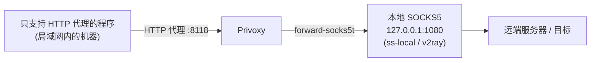

---
Title | Tools Networks Proxy Privoxy
-- | --
Created @ | `2026-11-26T09:26:09Z`
Updated @| `2026-11-26T09:26:09Z`
Labels | ``
Edit @| [here](https://github.com/junxnone/linux/issues/139)

---
# Privoxy

Privoxy 是一个轻量的 **HTTP 代理 + 过滤器**，常见的用法有两个：一是**把 SOCKS5 代理转成 HTTP 代理**（让只认 HTTP 代理的程序也能用 [shadowsocks](0067_Tools_Networks_Proxy_shadowsocks)、[V2Ray](0066_Tools_Networks_Proxy_V2Ray) 这类提供 SOCKS5 的本地代理，或者把本机的代理共享给局域网里的其他机器）；二是按规则**过滤和改写**网页请求（去广告、拦截跟踪）。它可以替代已经停止维护的 Polipo。代理概念和各工具的配置见 [Proxy](0080_Tools_Networks_Proxy)。

## 工作方式

下图展示"SOCKS5 转 HTTP"的典型用法：



图中：

- 左边的程序（浏览器、`apt`、`git` 等）按 HTTP 代理协议连接 Privoxy 的 8118 端口；
- Privoxy 根据 `forward-socks5t` 规则把请求转发给本地的 SOCKS5 代理（`ss-local`、V2Ray 的 socks inbound 等）；
- 之后的加密中继由这些 SOCKS5 代理完成，Privoxy 本身不加密；
- 关键结论：Privoxy 只做"协议转换 + 路由"，选择哪个出口、用什么协议加密，由后面的 SOCKS5 代理决定。

## Install

```bash
sudo apt install privoxy
sudo systemctl enable --now privoxy
```

主配置文件是 `/etc/privoxy/config`，改完之后执行 `sudo systemctl restart privoxy`，日志默认在 `/var/log/privoxy/`。

## 基本配置

最常用的几行：

```
listen-address  127.0.0.1:8118
forward-socks5t / 127.0.0.1:1080 .
forward         192.168.0.*/  .
forward         localhost/    .
```

各行的含义：

行 | 含义
-- | --
`listen-address 127.0.0.1:8118` | Privoxy 监听的地址和端口；默认只监听本机。要给局域网共享就改成 `0.0.0.0:8118` 或具体的内网地址
`forward-socks5t / 127.0.0.1:1080 .` | 所有请求（`/` 表示所有 URL）通过 `127.0.0.1:1080` 的 SOCKS5 代理转发；末尾的 `.` 表示该 SOCKS 代理的上游不再经过另一个 HTTP 代理
`forward 192.168.0.*/ .` | 这些目标**不走**代理，直接连接（`.` 表示直连）；内网网段、`localhost` 要写在前面，让它们直连

表中第一列是配置行，第二列是含义。几个细节：

- **`socks5` 与 `socks5t`**：`forward-socks5` 由 Privoxy 在本地解析域名；`forward-socks5t` 是 `socks5` 的"透传"版本，**把域名交给 SOCKS 代理解析**，通常更合适（避免本地 DNS 污染或解析不出）。另外还有 `forward-socks4`、`forward-socks4a`。
- **规则顺序**：官方示例配置里，`forward ... .` 直连规则写在 `forward-socks5t / ...` 之后，用来保证内网目标直连。多条规则同时匹配时以靠后的为准（我没能联网核对手册原文，请以官方手册为准，并用 `curl -v` 实际验证内网地址是否直连）。
- 配置里 `#` 开头是注释，注意 `forward-socks5t` 的写法和末尾的 `.` 不能漏。

## 使用

客户端按 HTTP 代理使用 Privoxy：

```bash
export http_proxy=http://127.0.0.1:8118
export https_proxy=http://127.0.0.1:8118
curl -I https://example.com
```

局域网内其他机器把 `127.0.0.1` 换成这台机器的内网 IP。注意：**对局域网开放时要用防火墙或 `permit-access` 限制来源**，否则相当于开放了一个无需认证的代理。

## 过滤功能

Privoxy 的另一个核心功能是对 HTTP 请求和响应做过滤和改写，通过"动作（actions）"和"过滤器（filters）"配置：

- **动作文件**（如 `match-all.action`、`default.action`、`user.action`）：按 URL 模式决定对匹配的请求做什么，例如屏蔽（`+block`）、去除 Cookie、改写请求头。把自定义规则写在 `user.action` 里，升级时不会被覆盖。
- **过滤器文件**（`default.filter`、`user.filter`）：用正则替换网页内容，例如去掉特定脚本。
- 对 HTTPS，Privoxy 只能看到 `CONNECT host:port`，**看不到加密内容**，所以内容过滤只对 HTTP 有效；它默认不做 HTTPS 解密。

## 排错

- `ss -lntp | grep 8118` 确认在监听；
- `curl -v -x http://127.0.0.1:8118 https://example.com` 看是否连上、有没有收到错误；
- Privoxy 的状态页：把浏览器代理设为 Privoxy 后访问 `http://config.privoxy.org/`，能看到说明请求确实经过了 Privoxy；
- 访问变慢或失败时，先单独用 `curl -x socks5h://127.0.0.1:1080 ...` 验证后面的 SOCKS5 代理本身是否正常。

## 使用须知

- 对局域网开放前先限制来源，避免成为公开代理。
- Privoxy 本身不提供认证，不适合直接暴露在公网。
- 只在符合所在网络管理规定和当地法律法规的前提下使用。

## Reference

- [Privoxy 官网](https://www.privoxy.org/)
- [Privoxy 用户手册](https://www.privoxy.org/user-manual/index.html)
- [Privoxy 配置 - forward 指令](https://www.privoxy.org/user-manual/config.html#FORWARDING)

