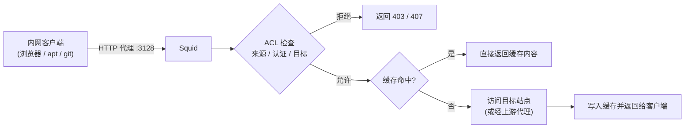

---
Title | Tools Networks Proxy Squid
-- | --
Created @ | `2026-11-26T09:26:14Z`
Updated @| `2026-11-26T09:26:14Z`
Labels | ``
Edit @| [here](https://github.com/junxnone/linux/issues/141)

---
# Squid

Squid 是一个历史悠久、功能完整的 **HTTP/HTTPS 缓存代理服务器**，在企业和校园网络里很常见：一台 Squid 放在内网出口，内网机器都通过它访问外部，这样可以统一做**访问控制、用户认证、日志审计和内容缓存**。它同时支持正向代理（Forward）和反向代理（Reverse，用来给 Web 服务器加缓存）。对 Linux 用户来说，最常见的两类场景是：自己搭一台缓存/出口代理给内网使用，以及配置机器使用公司已有的 Squid 代理出网。代理的整体概念和客户端配置见 [Proxy](0080_Tools_Networks_Proxy)。

## 工作方式

下图展示 Squid 作为内网出口代理时一次请求的处理流程：



图中：

- **客户端**：通过 HTTP 代理方式连接 Squid 的 3128 端口（默认端口）；
- **ACL 检查**：Squid 先根据访问控制规则（来源网段、用户名密码、目标域名等）决定是否放行，拒绝时返回 403（禁止）或 407（需要代理认证）；
- **缓存命中**：允许后检查本地缓存，命中则直接返回，节省带宽和时间；
- **未命中**：访问目标站点（或转发给上游代理），响应写入缓存后返回客户端；
- 关键结论：Squid 的价值不只是"转发"，更在于 ACL 访问控制和缓存；HTTPS 流量只能通过 `CONNECT` 隧道转发，无法被缓存（除非启用 SSL Bump 解密，见下）。

## Install

```bash
sudo apt install squid
sudo systemctl enable --now squid
```

主配置文件是 `/etc/squid/squid.conf`，默认监听 `3128` 端口；日志在 `/var/log/squid/`（`access.log` 是访问日志，`cache.log` 是运行日志）。

## 基本配置

默认配置只允许本机访问，要让内网机器使用，需要添加允许规则。编辑 `/etc/squid/squid.conf`（Debian/Ubuntu 也可以在 `/etc/squid/conf.d/` 下放自己的 `.conf` 文件，由主配置 `include` 进来）：

```
http_port 3128

acl localnet src 192.168.0.0/16
acl localnet src 10.0.0.0/8

http_access allow localnet
http_access deny all
```

各行的含义：

指令 | 含义
-- | --
`http_port 3128` | 监听的端口
`acl localnet src 192.168.0.0/16` | 定义名为 `localnet` 的访问控制列表（ACL）：来源 IP 属于这个网段
`http_access allow localnet` | 允许匹配 `localnet` 的请求
`http_access deny all` | 其他一律拒绝，**必须放在最后**

表中第一列是指令，第二列是含义。`http_access` 规则**自上而下匹配，先匹配先生效**，所以允许规则要放在 `deny all` 之前；另外，默认配置里已有的 `deny` 规则（如拒绝非安全端口）也在前面，自己的 `allow` 要加在它们之后、`deny all` 之前。

修改后先检查配置语法，再让 Squid 重新加载：

```bash
sudo squid -k parse          # 检查配置语法
sudo squid -k reconfigure    # 重新加载配置（或 sudo systemctl reload squid）
```

## 用户认证

在上面的规则前加入用户名密码认证（Basic 认证，以 htpasswd 文件为例）：

```bash
sudo apt install apache2-utils
sudo htpasswd -c /etc/squid/passwd alice       # 第一次用 -c 创建文件，之后添加用户不要再加 -c
```

```
auth_param basic program /usr/lib/squid/basic_ncsa_auth /etc/squid/passwd
auth_param basic realm Squid proxy
acl authenticated proxy_auth REQUIRED

http_access allow authenticated
http_access deny all
```

各项含义：

- `auth_param basic program ...`：指定验证用户名密码的程序和密码文件；程序路径在不同发行版可能不同，以实际安装位置为准；
- `acl authenticated proxy_auth REQUIRED`：定义 ACL，要求必须提供有效的代理认证；
- 未认证的客户端会收到 `407 Proxy Authentication Required`；
- 客户端使用时在代理地址里带上用户名密码：`http://alice:密码@proxy.example.com:3128`。Basic 认证的密码是**明文（Base64）传输**，不要在不可信网络里使用，需要时前面再加 TLS 或限制来源网段。

## 缓存

缓存相关的两个常用设置：

```
cache_mem 256 MB
cache_dir ufs /var/spool/squid 10000 16 256
maximum_object_size 512 MB
```

各项含义：

- `cache_mem`：内存缓存大小；
- `cache_dir ufs /var/spool/squid 10000 16 256`：磁盘缓存，依次是存储类型、目录、**大小（MB）**、一级目录数、二级目录数；这里是 10000 MB（约 10 GB）；
- `maximum_object_size`：允许缓存的单个对象的最大值，要缓存软件包（如 apt 的 .deb）就要调大；
- 修改 `cache_dir` 后需要先创建缓存目录结构：`sudo squid -z`，再启动服务。

用 Squid 给内网的 apt 做缓存是一个典型用法：多台机器都走同一个 Squid，同一个软件包只从外网下载一次。

## 级联上游代理

如果出口需要再经过公司或上级代理，可以把它配置成上游（parent）：

```
cache_peer proxy.upstream.example.com parent 8080 0 no-query default
never_direct allow all
```

含义：`cache_peer ... parent 8080` 声明一个上游父代理；`no-query` 不使用 ICP 查询；`default` 作为默认的上游；`never_direct allow all` 要求所有请求都必须经过上游，不直接连目标。

## HTTPS 与 SSL Bump

- 对 HTTPS，普通配置下 Squid 只看到 `CONNECT host:443`，只能按**域名/端口**做访问控制，看不到内容，也无法缓存。
- Squid 还支持 **SSL Bump**：在代理上解密 HTTPS 再重新加密，用于内容检查和缓存。这需要给所有客户端安装 Squid 自己的 CA 根证书，配置和合规要求较高，且会让代理看到明文内容；不是必须不要启用。

## 常用命令与排错

```bash
sudo systemctl status squid          # 服务状态
sudo squid -k parse                  # 检查配置
sudo tail -f /var/log/squid/access.log    # 实时看访问日志
curl -v -x http://127.0.0.1:3128 https://example.com   # 测试代理
```

访问日志每行里的 `TCP_HIT`、`TCP_MISS`、`TCP_TUNNEL`、`TCP_DENIED` 分别表示缓存命中、缓存未命中、HTTPS 隧道和被拒绝，可以用来判断缓存是否生效、规则是否拦截了请求。

- **客户端收到 403**：来源 IP 不在允许的 ACL 里，或 `allow` 规则写在了 `deny` 之后。
- **收到 407**：需要认证，检查客户端是否带了用户名密码，以及密码文件和认证程序路径是否正确。
- **启动失败**：先 `squid -k parse` 看配置语法；缓存目录权限不对时，用 `squid -z` 重建。
- **下载大文件失败/被截断**：检查 `maximum_object_size` 和 `read_timeout` 等超时设置。

## 使用须知

- 开放给网络前务必配置 ACL，不要允许任意来源使用（"开放代理"会被滥用）。
- 代理会记录访问日志，涉及用户隐私和合规时要有明确的使用和告知规则。
- 只在符合所在网络管理规定和当地法律法规的前提下使用。

## Reference

- [Squid 官网](http://www.squid-cache.org/)
- [Squid 配置参考](http://www.squid-cache.org/Doc/config/)
- [Squid Wiki](https://wiki.squid-cache.org/)
- [Ubuntu - Squid 服务器](https://documentation.ubuntu.com/server/how-to/web-services/install-a-squid-server/)

