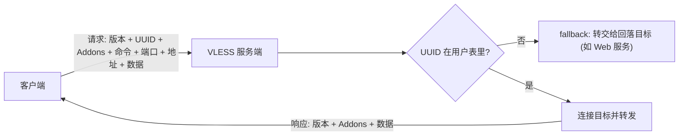

---
Title | Tools Networks Proxy Protocol VLESS
-- | --
Created @ | `2026-11-26T10:10:40Z`
Updated @| `2026-11-26T10:10:40Z`
Labels | ``
Edit @| [here](https://github.com/junxnone/linux/issues/143)

---
# VLESS

VLESS 是一个**无状态的轻量传输协议**，由 Xray/V2Ray 社区提出，可以看作 [VMess](0066_Tools_Networks_Proxy_V2Ray) 的精简版：它自己**不做加密**，只负责"认证用户 + 说明目标地址"，加密交给下层的 TLS（或后来的 VLESS Encryption）。因为去掉了协议内加密，开销更小，并且可以和 XTLS Vision 流控配合，避免对 TLS 数据"二次加密"。VLESS 不依赖系统时间，认证方式是 UUID。总览见 [Proxy](0080_Tools_Networks_Proxy)。

## 工作方式

下图展示 VLESS 请求和响应的结构：



图中：

- **请求**依次是：1 字节协议版本、16 字节 UUID、1 字节 Addons 长度和 Addons（ProtoBuf 编码的扩展信息）、1 字节命令、2 字节端口、1 字节地址类型和地址，然后是请求数据。
- **响应**非常简短：1 字节协议版本（与请求相同，同时起到响应认证的作用）、Addons 长度和 Addons，然后是响应数据。
- **Addons**：用 ProtoBuf 做可扩展字段（例如流控 `flow`），不用时长度为 0，没有序列化开销。
- **服务端校验**：只查 UUID 是否在用户表中，查找很快，能支持大量用户，也可以通过 API 动态增删用户。
- **回落（fallback）**：认证失败的连接可以转交给另一个目标（例如本机的 Web 服务），使服务端看起来像普通站点。
- 关键结论：VLESS 把"安全"和"代理"拆开——加密由 TLS/Encryption 提供，协议只描述连接请求本身。

## 与 VMess 的区别

对比 | VMess | VLESS
-- | -- | --
数据加密 | 协议内自带（`security`） | 协议内不加密，交给 TLS 或 VLESS Encryption
时间依赖 | 依赖系统时间，误差要在 90 秒内 | 不依赖系统时间
认证 | UUID + 时间戳派生 | UUID
扩展方式 | 固定字段 | ProtoBuf 编码的 Addons
性能 | 有协议内加密开销 | 开销小，可与 XTLS Vision 配合直接拷贝 TLS 数据
配置 | `security`、`alterId` | `encryption`（需显式写 `none`）、`flow`

表中第一列是对比项，后两列分别是两个协议的做法。VLESS 是无状态协议，不依赖时间，所以对服务器时间不同步更宽容。

## 配置要点

服务端入站（以 Xray 为例，字段名以所用版本文档为准）：

```json
{
  "inbounds": [{
    "port": 443,
    "protocol": "vless",
    "settings": {
      "clients": [{ "id": "5783a3e7-e373-51cd-8642-c83782b807c5", "flow": "xtls-rprx-vision" }],
      "decryption": "none",
      "fallbacks": [{ "dest": 80 }]
    },
    "streamSettings": { "network": "tcp", "security": "tls" }
  }]
}
```

其中：

- `id`：用户 ID，合法的 UUID，也可以是小于 30 字节的自定义字符串（会被映射为一个 UUID，等价使用）；
- `flow`：流控模式，空表示普通 TLS 代理，`xtls-rprx-vision` 表示使用 XTLS Vision（只能与 TCP + TLS/REALITY 搭配，见 XTLS 文章）；
- `decryption`：**不能留空**，不使用 VLESS Encryption 时必须显式写 `"none"`（客户端对应字段叫 `encryption`）；
- `fallbacks`：认证失败的连接转交到哪里；
- 官方文档强调：**VLESS 必须配合传输安全层使用**（TLS 或 REALITY），只有对端是受信网络里的私有地址，或已启用 VLESS Encryption 时，才允许 `security` 为 `none`。

## 命令与扩展

- 命令字段：TCP、UDP，另有 Mux（多路复用）。
- **VLESS Encryption**：较新的可选加密方案，`decryption`/`encryption` 字段由 `xray vlessenc` 自动生成，握手方式为 `mlkem768x25519plus`（含后量子算法 ML-KEM-768），并带有流量填充选项；不需要时仍写 `none`。
- **反向代理**：用户可配置 `reverse` 字段，让该用户的连接用来建立反向代理隧道。

## 优缺点

优点 | 缺点
-- | --
协议轻量、开销小，不依赖时间 | 自己不加密，**必须**配合 TLS 等安全层，否则明文
UUID 校验快，用户数量大时性能好 | 不同实现（v2fly 与 Xray）对 VLESS 的支持和扩展不完全一致
可配合 XTLS Vision 减少二次加密、提升性能 | 配置字段与行为随版本变化较快，要以所用版本的文档为准
支持 fallback，服务端可伪装成普通 Web 站点 | 协议演进较快，文档分散

表中左边是优点，右边是缺点。

## 使用须知

- 只在符合所在网络管理规定和当地法律法规的前提下使用。
- UUID 等同于账号凭据，不要提交到公开仓库。

## Reference

- [VLESS Protocol - Xray 文档](https://github.com/XTLS/Xray-docs-next/blob/main/docs/en/development/protocols/vless.md)
- [VLESS - Xray 入站配置](https://github.com/XTLS/Xray-docs-next/blob/main/docs/config/inbounds/vless.md)
- [Xray-core](https://github.com/XTLS/Xray-core)

