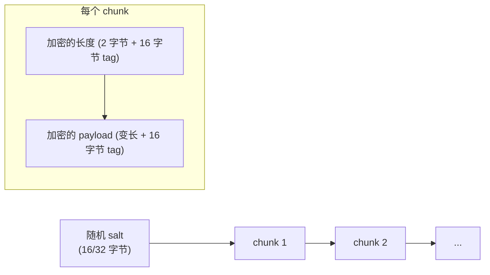

---
Title | Tools Networks Proxy Protocol Shadowsocks
-- | --
Created @ | `2026-11-26T10:10:42Z`
Updated @| `2026-11-26T10:10:42Z`
Labels | ``
Edit @| [here](https://github.com/junxnone/linux/issues/144)

---
# Shadowsocks

本文讲的是 Shadowsocks **协议本身**：数据在网络上是什么格式、怎么加密、有哪些版本；安装、配置和各种实现见 [shadowsocks](0067_Tools_Networks_Proxy_shadowsocks)。Shadowsocks 是一个基于 SOCKS5 风格地址格式的加密代理协议：客户端和服务端共享一个预置密钥（PSK），**没有握手**，客户端第一包就带着目标地址和数据。在 V2Ray 里它既可以作为入站也可以作为出站使用，可以和现有的 SS 服务端互通。总览见 [Proxy](0080_Tools_Networks_Proxy)。

## 协议的三个阶段

Shadowsocks 经历了三代，核心差别是加密方式：

版本 | 加密 | 状态
-- | -- | --
Stream（流加密） | aes-*-cfb、aes-*-ctr、rc4-md5、chacha20 等，只加密不认证 | 官方文档称已被"完全破解"，将被移除，新用户必须使用 AEAD
AEAD（2017，SIP004/SIP007） | chacha20-ietf-poly1305、aes-256-gcm、aes-128-gcm，带认证 | 推荐使用
AEAD-2022（SIP022） | 2022-blake3-aes-128-gcm、2022-blake3-aes-256-gcm | 最新版，强制重放保护

表中第一列是版本，第二列是典型加密方式，第三列是现状。选择建议：新部署用 AEAD 或 2022 版，不要再使用任何流加密。

## AEAD 版的数据格式

下图展示 AEAD 版一条 TCP 连接上数据的结构：

图中：

- 一条 TCP 流以一个**随机 salt** 开头，用它和主密钥派生出**本次会话的子密钥**（子密钥派生函数是 HKDF_SHA1，info 字符串是 `ss-subkey`）；
- 之后是任意多个 chunk，每个 chunk 先是加密的"长度"（2 字节大端整数，最大 `0x3FFF`，即单块 payload 最多 16383 字节，外加 16 字节认证标签），再是加密的 payload（外加 16 字节标签）；
- 每个 chunk 做两次 AEAD 操作（长度一次、数据一次），**nonce 从 0 开始，每次操作加 1**；
- 第一个 chunk 的 payload 开头就是目标地址（SOCKS5 地址格式），所以"请求头"藏在加密数据里；
- UDP 则是每个数据包独立：salt + 加密的 payload + 标签，nonce 全零。
- 关键结论：任何一个 chunk 被篡改，认证标签就会校验失败，连接被拒绝；这是 AEAD 相对流加密最重要的改进。

AEAD 推荐的加密算法：

名称 | 别名 | 密钥/salt 长度 | nonce | tag
-- | -- | -- | -- | --
AEAD_CHACHA20_POLY1305 | chacha20-ietf-poly1305 | 32 / 32 | 12 | 16
AEAD_AES_256_GCM | aes-256-gcm | 32 / 32 | 12 | 16
AEAD_AES_128_GCM | aes-128-gcm | 16 / 16 | 12 | 16

表中的长度单位都是字节；规范要求所有实现都必须支持 chacha20-ietf-poly1305，有 AES 硬件加速的设备还应支持 AES-GCM。主密钥可以直接给，也可以用密码按 OpenSSL 的 `EVP_BytesToKey` 派生。

## AEAD-2022 做了哪些改进

AEAD-2022（SIP022）在 AEAD 的基础上解决已知问题：

- **强制重放保护**：请求头里带 8 字节的 Unix 时间戳，**时间差超过 30 秒的消息必须当作重放**；每条消息有唯一的类型，不能被挪作他用。
- **PSK 必须是随机密钥**：不再允许用 `EVP_BytesToKey` 从密码派生，密钥用 base64 编码，可以用 `openssl rand -base64 <key_size>` 生成（这一做法借鉴了 WireGuard）。
- **改用 BLAKE3** 的密钥派生模式替代 HKDF_SHA1：`session_subkey = blake3::derive_key("shadowsocks 2022 session subkey", key + salt)`。
- **请求头加了填充**：请求头里要有 payload 或随机长度的 padding（0 到 900 字节），防止请求长度特征。
- **会话式 UDP**：减少协议开销、提高效率；单个 payload chunk 最大可到 65535 字节，不再受 16383 限制。
- **仍然没有前向保密**：规范明确说明使用预共享密钥、没有握手，这是有意的设计。

## 优缺点

优点 | 缺点
-- | --
协议极简，实现多、资源占用低 | 没有握手，也**没有前向保密**，PSK 泄露后历史流量可被解密（若被保存）
AEAD 提供加密和认证，流量看起来像随机字节 | 流量没有 TLS 外观，在有深度包检测的环境里更容易被识别为"不明加密流量"
所有主流客户端、路由器固件都支持 | 功能单一，没有路由、多出口、多种传输（这些要靠 V2Ray 等平台）
UDP、TCP 都支持 | 旧加密方式不安全，仍有存量服务端在用

表中左边是优点，右边是缺点。需要分流和多种传输时选 V2Ray 一类，只需要简单加密中继时选 Shadowsocks。

## 插件机制

SIP003 定义了插件接口：客户端和服务端各启动一个插件进程，Shadowsocks 与插件之间用本地端口通信，由插件负责额外的传输层处理，例如 WebSocket + TLS（v2ray-plugin）。配置里用 `plugin` 和 `plugin_opts` 指定。

## 使用须知

- 只在符合所在网络管理规定和当地法律法规的前提下使用。
- 密钥是整条链路的唯一凭据，应使用足够长的随机值。

## Reference

- [AEAD ciphers - shadowsocks.org](https://github.com/shadowsocks/shadowsocks-org/blob/main/docs/doc/aead.md)
- [Stream ciphers - shadowsocks.org](https://github.com/shadowsocks/shadowsocks-org/blob/main/docs/doc/stream.md)
- [SIP022 AEAD-2022 Ciphers](https://github.com/shadowsocks/shadowsocks-org/blob/main/docs/doc/sip022.md)
- [SIP003 Plugin](https://github.com/shadowsocks/shadowsocks-org/blob/main/docs/doc/sip003.md)

