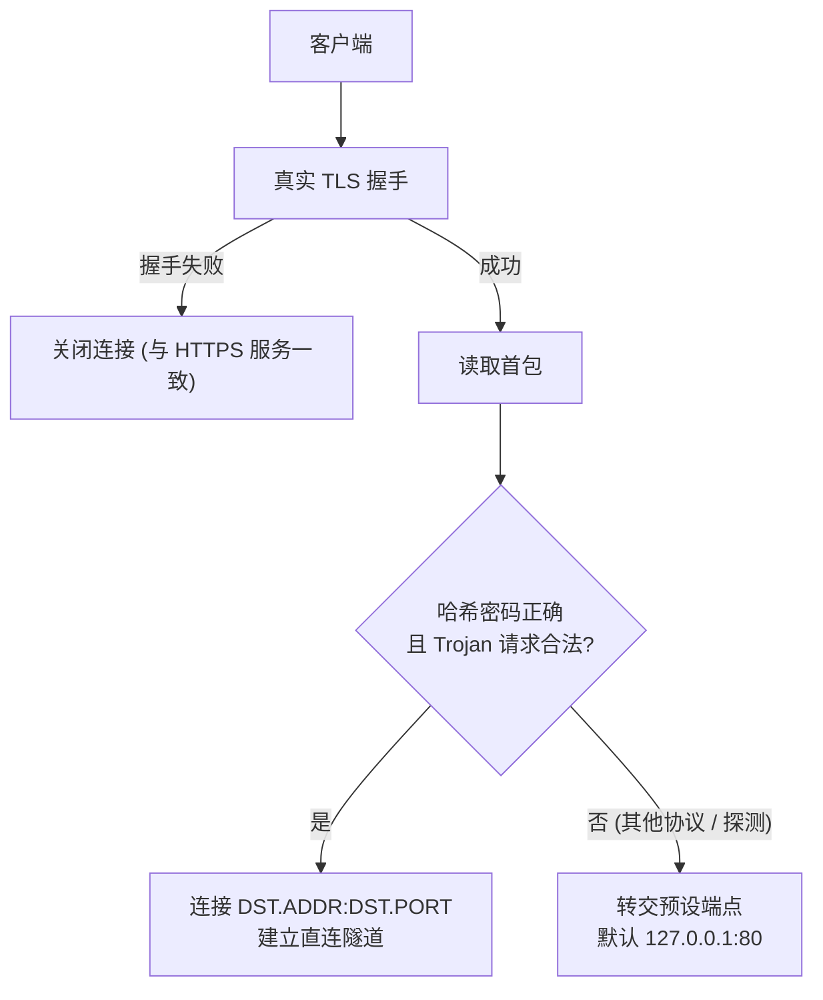

---
Title | Tools Networks Proxy Protocol Trojan
-- | --
Created @ | `2026-11-26T10:10:44Z`
Updated @| `2026-11-26T10:10:44Z`
Labels | ``
Edit @| [here](https://github.com/junxnone/linux/issues/145)

---
# Trojan

Trojan 是一个**以真实 TLS 为外壳**的代理协议：客户端和服务端先完成一次真正的 TLS 握手，之后所有流量都受 TLS 保护，因此从网络上看它与普通的 HTTPS 流量一致。认证用的是密码的哈希值；服务端遇到不是 Trojan 协议的流量（比如浏览器或探测）时，会把它交给一个预设的后端（默认是本机 80 端口的 HTTP 服务），所以服务端表现得就像一个普通的 HTTPS 网站。V2Ray 系的实现（如 v2fly v5、Xray）也支持 Trojan 协议。总览见 [Proxy](0080_Tools_Networks_Proxy)。

## 工作方式

下图展示服务端收到连接后的处理分支：



图中：

- **TLS 握手**：客户端先做一次真实的 TLS 握手。握手失败时，服务端就像任何 HTTPS 服务器一样直接关闭连接。使用者需要自己配置有效的证书。
- **首包校验**：握手成功后，服务端读取第一个数据包，检查其中的哈希密码和 Trojan 请求是否合法。
- **合法**：服务端连接请求里指定的目标地址和端口，然后在客户端和目标之间转发数据。
- **不合法**：认为是"其他协议"（浏览器访问、主动探测等），把解密后的流量转交给预设端点（默认是本机的 HTTP 服务），服务端的外在表现就是那个端点的行为。
- 关键结论：对探测者来说，服务器是一个能正常返回网页的 HTTPS 站点，只有知道密码的客户端才会被当作代理流量。

## 报文格式

客户端在 TLS 通道内发送的结构：

```
+-----------------------+---------+----------------+---------+----------+
| hex(SHA224(password)) |  CRLF   | Trojan Request |  CRLF   | Payload  |
+-----------------------+---------+----------------+---------+----------+
|          56           | X'0D0A' |    Variable    | X'0D0A' | Variable |
+-----------------------+---------+----------------+---------+----------+

Trojan Request 类似 SOCKS5 请求:
+-----+------+----------+----------+
| CMD | ATYP | DST.ADDR | DST.PORT |
+-----+------+----------+----------+
|  1  |  1   | Variable |    2     |
+-----+------+----------+----------+
```

各字段含义：

字段 | 含义
-- | --
`hex(SHA224(password))` | 密码的 SHA-224 哈希的十六进制字符串，固定 56 个可打印字符
CRLF | 回车换行 `X'0D0A'`，分隔各部分
CMD | 命令：`X'01'` CONNECT（TCP）、`X'03'` UDP ASSOCIATE
ATYP | 地址类型：`X'01'` IPv4、`X'03'` 域名、`X'04'` IPv6
DST.ADDR / DST.PORT | 目标地址和端口（端口为网络字节序）
Payload | 实际数据；首包里可以附带 payload，避免出现可识别的包长特征，也能少发一个包

表中第一列是字段名，第二列是含义。UDP 的每个数据包格式为 `ATYP | DST.ADDR | DST.PORT | Length | CRLF | Payload`，其中 `Length` 是 payload 的长度（2 字节）。

## 抗检测思路

- **主动探测**：没有正确结构和密码的连接都会被转交到预设端点，服务端的行为与该端点完全一致（默认就是一个 HTTP 站点）。
- **被动检测**：流量由 TLS 保护，访问 HTTP 站点时与 HTTPS 一样（TLS 握手后只有一个 RTT），不访问站点时看起来像保持连接的 HTTPS 或 WebSocket。
- **与 VLESS 的相似点**：两者都把"安全"交给 TLS，并支持回落；区别是 Trojan 的认证是 56 字节的密码哈希，没有 Addons 扩展，也没有协议版本字段，而 VLESS 用 UUID 并带有可扩展字段。

## 配置要点

服务端必须有**有效证书**（通常用 Let's Encrypt 签发的域名证书）和一个可回落的 Web 服务：

```json
{
  "run_type": "server",
  "local_addr": "0.0.0.0",
  "local_port": 443,
  "remote_addr": "127.0.0.1",
  "remote_port": 80,
  "password": ["请换成足够长的随机密码"],
  "ssl": {
    "cert": "/path/to/fullchain.pem",
    "key": "/path/to/privkey.pem"
  }
}
```

其中：

- `remote_addr` / `remote_port`：**回落目标**，即上面说的"预设端点"，通常是本机的 Nginx 站点；
- `password`：可以有多个，每个都是一个有效用户；
- `ssl.cert`、`ssl.key`：服务端证书和私钥；证书应当与客户端使用的域名一致，客户端需要校验证书；
- 上面是官方 trojan 项目（trojan-gfw/trojan）的配置格式；V2Ray/Xray 里的 Trojan 入站/出站的字段名不同，以所用版本的文档为准。

## 优缺点

优点 | 缺点
-- | --
真实 TLS，外观与 HTTPS 一致，不需要自研加密 | 必须有域名和有效证书，部署和续签有成本
服务端可回落到真实网站，主动探测不易识别 | TLS 内再包一层 TLS 的"TLS in TLS"流量特征可被分析
协议简单，实现和排错容易 | 没有路由、多出口等高级功能，通常配合 V2Ray/Xray/sing-box 使用
几乎所有主流客户端都支持 | 需要保证回落站点自身也像一个正常站点

表中左边是优点，右边是缺点。VLESS 的 Vision 流控和 REALITY 针对的就是"TLS in TLS"特征和证书部署这两个问题。

## 使用须知

- 只在符合所在网络管理规定和当地法律法规的前提下使用。
- 密码是唯一凭据，应使用足够长的随机串，不要提交到公开仓库。

## Reference

- [The Trojan Protocol - trojan-gfw](https://github.com/trojan-gfw/trojan/blob/master/docs/protocol.md)
- [trojan-gfw/trojan - Github](https://github.com/trojan-gfw/trojan)
- [RFC 1928 - SOCKS Protocol Version 5](https://datatracker.ietf.org/doc/html/rfc1928)

