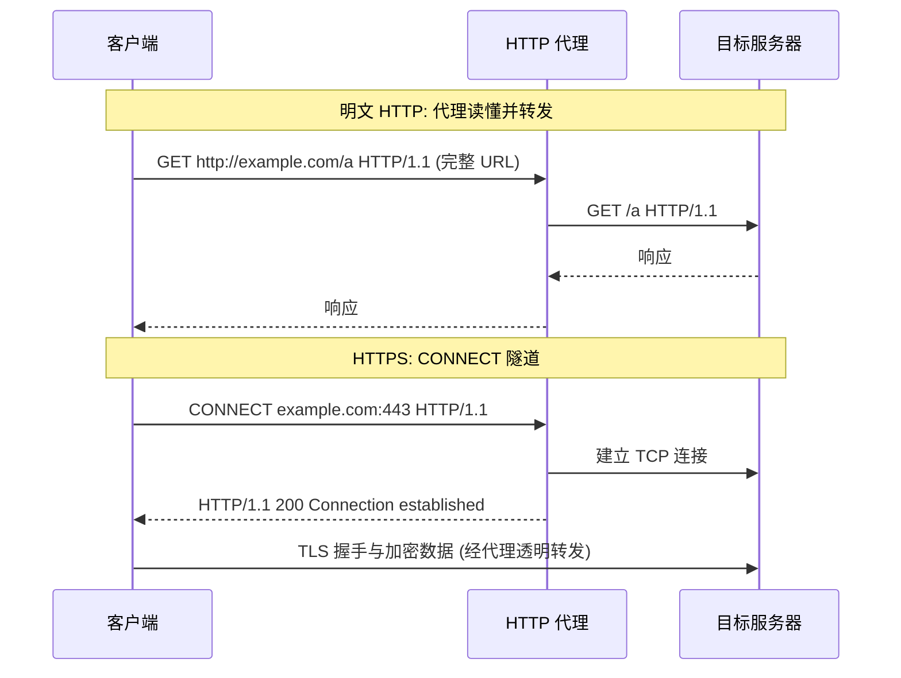

---
Title | Tools Networks Proxy Protocol HTTP
-- | --
Created @ | `2026-11-26T10:13:35Z`
Updated @| `2026-11-26T10:13:35Z`
Labels | ``
Edit @| [here](https://github.com/junxnone/linux/issues/147)

---
# HTTP

HTTP 代理是最常见的代理形式：浏览器、curl、`apt`、`git` 等都原生支持。客户端把请求发给代理，由代理代为访问目标。HTTP 代理对**明文 HTTP**和**HTTPS**的处理方式不同：HTTP 请求代理可以直接读懂并转发；HTTPS 请求则通过 `CONNECT` 方法让代理建立一条到目标的 TCP 隧道，代理看不到 TLS 里的内容。V2Ray 的 `http` 协议既能做入站，也能做出站。总览见 [Proxy](0080_Tools_Networks_Proxy)，各工具的代理配置见同文。

## 工作方式

下图对比两种请求在 HTTP 代理上的处理过程：



图中：

- **明文 HTTP**：客户端发给代理的请求行里带**完整 URL**（绝对形式），代理解析后向目标发出普通请求，并把响应返回。代理能看到并修改请求内容，所以可以做缓存、过滤、记录。
- **HTTPS（CONNECT）**：客户端先发送 `CONNECT host:port`，代理连到目标后返回 `200`，之后双方的 TLS 握手和加密数据都由代理**不解析、只转发**；因此代理只知道目标主机名和端口，看不到内容。
- 关键结论：HTTPS 经 HTTP 代理时端到端加密不被破坏（除非代理做中间人解密），但代理仍能看到你访问了哪个域名。

## 认证

代理需要认证时，返回 **`407 Proxy Authentication Required`** 并带 `Proxy-Authenticate` 头；客户端再次请求时带上 `Proxy-Authorization` 头：

```
Proxy-Authorization: Basic base64(用户名:密码)
```

其中 `Basic` 是认证方案，`base64(用户名:密码)` 是把 `用户名:密码` 做 Base64 编码（**只是编码，不是加密**）。所以 Basic 认证在不加密的链路上会泄露密码；需要更强保护时，应让到代理的连接本身使用 TLS（"HTTPS 代理"），或者限制来源网段。

## 配置示例

入站（本机提供 HTTP 代理）和出站（通过上游 HTTP 代理转发）：

```json
{
  "inbounds": [{
    "port": 8080,
    "listen": "127.0.0.1",
    "protocol": "http",
    "settings": { "accounts": [{ "user": "my-username", "pass": "my-password" }] }
  }],
  "outbounds": [{
    "protocol": "http",
    "settings": { "servers": [{ "address": "192.168.108.1", "port": 3128, "users": [{ "user": "my-username", "pass": "my-password" }] }] }
  }]
}
```

字段含义：

- `accounts`：入站的账号列表，**不为空时启用 HTTP Basic 认证**；
- `allowTransparent`：为 `true` 时转发所有 HTTP 请求（而不只是代理请求），配置不当会导致死循环；
- `timeout`：读取客户端数据的超时（秒）；
- 出站里 `servers` 是上游 HTTP 代理，`users` 是上游需要的认证信息。

官方文档提示：HTTP 代理本身**不加密传输**，不适合直接经公网使用，也容易被当作攻击跳板；更合适的用法是在局域网或本机提供本地代理服务。Linux 上让命令行走它：

```bash
export http_proxy=http://127.0.0.1:8080/
export https_proxy=$http_proxy
```

## 优缺点

优点 | 缺点
-- | --
几乎所有软件原生支持，配置最简单 | 明文 HTTP 请求内容对代理完全可见
对 HTTP 可以做缓存、过滤、审计（如 [Squid](0141_Tools_Networks_Proxy_Squid)） | 不加密，Basic 认证密码仅 Base64 编码
HTTPS 通过 CONNECT，端到端加密不被破坏 | 只代理 TCP，不支持 UDP
可与 [Privoxy](0139_Tools_Networks_Proxy_Privoxy) 把 SOCKS 转成 HTTP 代理 | 对非 HTTP 的应用，有的不能通过 CONNECT 连接任意端口（代理通常限制只允许 443）

表中左边是优点，右边是缺点。需要通用的 TCP/UDP 转发时选 SOCKS，需要缓存和过滤时选 HTTP 代理。

## Reference

- [RFC 9110 - HTTP Semantics (CONNECT 方法)](https://www.rfc-editor.org/rfc/rfc9110.html#name-connect)
- [RFC 7235 - HTTP Authentication](https://www.rfc-editor.org/rfc/rfc7235)
- [HTTP - V2Fly 配置文档](https://github.com/v2fly/v2fly-github-io/blob/master/docs/en_US/config/protocols/http.md)

