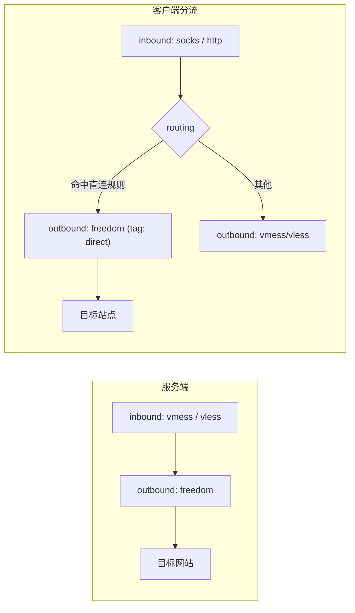

---
Title | Tools Networks Proxy Protocol Freedom
-- | --
Created @ | `2026-11-26T10:13:40Z`
Updated @| `2026-11-26T10:13:40Z`
Labels | ``
Edit @| [here](https://github.com/junxnone/linux/issues/149)

---
# Freedom

Freedom 是 V2Ray/Xray 里最基础的**出站协议**：它不经过任何代理，**直接把数据发往目标**，也就是"直连"。在分流场景里，它扮演"国内流量直连"的出口；在服务端，它是代理请求最终到达目标网站的出口。严格来说它不是一个网络协议，而是一个内置的出站处理器。总览见 [Proxy](0080_Tools_Networks_Proxy)，所在位置见 [V2Ray](0066_Tools_Networks_Proxy_V2Ray)。

## 工作方式

下图展示 Freedom 在"服务端"和"客户端分流"两种位置的作用：



图中：

- **服务端**：入站收到客户端的 VMess/VLESS 请求，解出目标地址后，用 Freedom 出站直接去访问目标，这里的"直连"是**服务端自己的网络**。
- **客户端分流**：路由把命中的流量（如国内域名、私有地址）交给带 `direct` 标签的 Freedom 出站，不走代理；没命中的走代理出站。
- 关键结论：Freedom 就是"不绕路"的出口，是否使用它由路由规则决定。

## 配置

```json
{
  "protocol": "freedom",
  "tag": "direct",
  "settings": {
    "domainStrategy": "AsIs",
    "redirect": "127.0.0.1:3366"
  }
}
```

字段含义：

字段 | 含义
-- | --
`domainStrategy` | 目标是域名时的处理方式：`AsIs` 直接用域名发起连接（默认）；`UseIP`、`UseIPv4`、`UseIPv6` 先用 V2Ray 内置 DNS 解析成 IP 再连接
`redirect` | 强制把所有数据发往指定地址（忽略入站给出的目标）；格式 `地址:端口`，地址省略（如 `:443`）则不改原目标地址，端口为 `0` 则不改原端口
`userLevel` | 用户等级，对应策略里的 `level`

表中第一列是字段，第二列是含义。`domainStrategy` 为 `UseIPv4`/`UseIPv6` 时只用对应版本的 IP，与 `sendThrough` 指定的本地地址不匹配时连接会失败。`UseIP` 系列依赖内置 DNS，参见 DNS 配置。

## 使用建议

- 第一个 `outbound` 是默认出口，**服务端通常只需要一个 `freedom`**。
- 客户端里给 Freedom 起个 `tag`（如 `direct`），再在路由规则里引用它。
- 通常把 Freedom 放在出站列表**靠后**的位置，把代理出站放在第一个，让"未命中规则的流量默认走代理"。
- `redirect` 常用来做端口转发，但更常用的是 `dokodemo-door`（见 DokodemoDoor 文章）。

## 优缺点

优点 | 缺点
-- | --
最简单，零开销，不加密不转发 | 流量不受保护，目标能看到你的真实出口 IP
内置的"直连"出口，与路由配合做分流 | 不是网络协议，无法单独使用，必须有入站和路由配合
`domainStrategy` 可控制 DNS 解析行为 | 配置了 `UseIP` 时依赖 DNS 配置，错误的 DNS 会导致连接失败

表中左边是优点，右边是缺点。

## Reference

- [Freedom - V2Fly 配置文档](https://github.com/v2fly/v2fly-github-io/blob/master/docs/en_US/config/protocols/freedom.md)
- [Routing - V2Fly 配置文档](https://github.com/v2fly/v2fly-github-io/blob/master/docs/en_US/config/routing.md)

