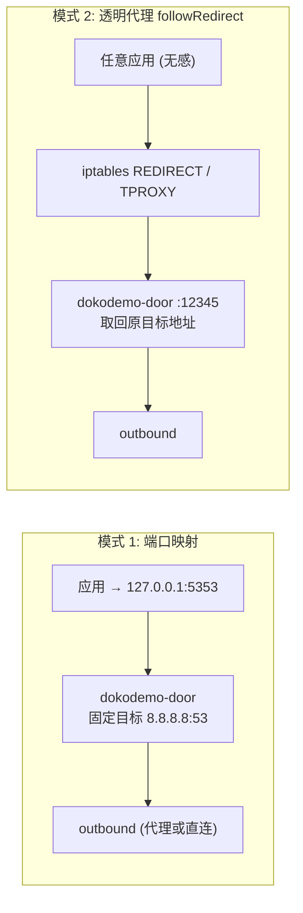

---
Title | Tools Networks Proxy Protocol DokodemoDoor
-- | --
Created @ | `2026-11-26T10:13:45Z`
Updated @| `2026-11-26T10:13:45Z`
Labels | ``
Edit @| [here](https://github.com/junxnone/linux/issues/151)

---
# DokodemoDoor

dokodemo-door（"任意门"）是 V2Ray 的**入站协议**：它监听一个本地端口，把进来的所有数据**原样转发**到指定的目标地址和端口，实现**端口映射**；开启 `followRedirect` 后还能识别被 iptables 重定向进来的流量，转发到流量**原本要去的地址**，从而实现**透明代理**。它不是网络协议，而是一个内置的入站处理器。在 Xray 的新版本里，它被改名为 **Tunnel**（旧称 dokodemo-door）。总览见 [Proxy](0080_Tools_Networks_Proxy)。

## 两种用法

下图对比 dokodemo-door 的两种工作模式：



图中：

- **模式 1（端口映射）**：在配置里写死 `address` 和 `port`，不管进来什么数据，都被当作发往这个地址的流量，再由路由和出站处理，常用来把本地 53 端口的 DNS 请求转发到上游 DNS。
- **模式 2（透明代理）**：不写目标地址，`followRedirect` 设为 `true`，让 dokodemo-door 从被重定向的连接里取回"原始目标地址"，因此应用完全不需要知道有代理存在；重定向动作由 iptables/nftables 完成。
- 关键结论：dokodemo-door 本身只负责"接住被重定向的流量并还原目标"，把流量交给路由和出站，是否走代理由后面的规则决定。

## 配置

端口映射模式（`address` 与 `port` 必填，`port` 必填）：

```json
{
  "port": 5353,
  "listen": "127.0.0.1",
  "protocol": "dokodemo-door",
  "settings": { "address": "8.8.8.8", "port": 53, "network": "tcp,udp", "timeout": 0 }
}
```

透明代理模式：

```json
{
  "port": 12345,
  "protocol": "dokodemo-door",
  "settings": { "network": "tcp,udp", "timeout": 30, "followRedirect": true },
  "streamSettings": { "sockopt": { "tproxy": "tproxy" } }
}
```

字段含义：

字段 | 含义
-- | --
`address` | 转发的目标地址（IP 或域名）；`followRedirect` 为 `true` 时可省略
`port` | 转发的目标端口，范围 1–65535，必填
`network` | 接收的网络类型：`tcp`、`udp` 或 `tcp,udp`，默认 `tcp`
`timeout` | 入站数据的时限（秒），默认 300
`followRedirect` | 为 `true` 时识别 iptables 转发进来的数据并还原目标地址
`userLevel` | 用户等级

表中第一列是字段，第二列是含义。透明代理里的 `sockopt.tproxy` 取 `off`、`redirect` 或 `tproxy`：`redirect` 适用于 TCP（iptables 的 REDIRECT），`tproxy` 适用于 UDP 和 TCP（iptables 的 TPROXY），需要 `CAP_NET_ADMIN` 权限。Xray 新版里该项对应 `tunnel` 协议，字段改名为 `rewriteAddress`、`rewritePort`、`allowedNetwork`，并新增 `portMap`，使用 Xray 时以其文档为准。

## 透明代理示例

官方文档给出的 iptables 配置思路（节选）：

```bash
# 新建链
iptables -t nat -N V2RAY
# 放行服务器自己的地址，避免回环（非常重要）
iptables -t nat -A V2RAY -d 123.123.123.123 -j RETURN
# 放行内网和保留地址
iptables -t nat -A V2RAY -d 10.0.0.0/8 -j RETURN
iptables -t nat -A V2RAY -d 192.168.0.0/16 -j RETURN
# 其余 TCP 流量重定向到 dokodemo-door 的端口
iptables -t nat -A V2RAY -p tcp -j REDIRECT --to-ports 12345
# 应用到本机出站流量
iptables -t nat -A OUTPUT -p tcp -j V2RAY
```

要点：

- **必须放行代理服务器自己的地址**，否则代理自己的连接又被重定向回来，形成死循环；
- 内网、回环、组播等保留地址要放行，让它们直连；
- UDP 要用 `mangle` 表的 TPROXY 规则加策略路由（`ip rule`/`ip route`），配置更复杂；
- 更完整的说明和排错见 V2Ray Transparent 文章。

## 优缺点

优点 | 缺点
-- | --
可以代理**不支持代理设置**的程序，对应用无感 | 配置复杂，容易出现回环和遗漏
一个入站就能实现端口映射，常用于转发 DNS | 需要 root/`CAP_NET_ADMIN`，只能在 Linux 上使用 iptables/nftables 方案
支持 TCP、UDP | 只还原"目标地址"，若想用域名路由需要嗅探（sniffing）才能拿到域名
与路由规则配合，做精细分流 | 在容器、路由器等环境里需要额外处理网络命名空间和权限

表中左边是优点，右边是缺点。

## Reference

- [Dokodemo-door - V2Fly 配置文档](https://github.com/v2fly/v2fly-github-io/blob/master/docs/en_US/config/protocols/dokodemo.md)
- [Tunnel（旧称 dokodemo-door） - Xray 文档](https://github.com/XTLS/Xray-docs-next/blob/main/docs/config/inbounds/tunnel.md)

