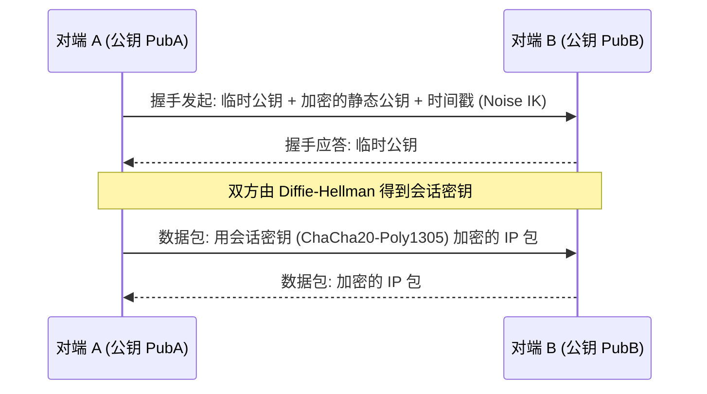

---
Title | Tools Networks Proxy Protocol WireGuard
-- | --
Created @ | `2026-11-26T10:13:47Z`
Updated @| `2026-11-26T10:13:47Z`
Labels | ``
Edit @| [here](https://github.com/junxnone/linux/issues/152)

---
# WireGuard

WireGuard 是一个现代的 **VPN 协议**：它在两端之间建立一条加密的 UDP 隧道，把 **IP 数据包**整个装进隧道里传输。和上面几种"代理协议"（只转发 TCP/UDP 连接）不同，WireGuard 工作在**网络层（IP 层）**，更像一块虚拟网卡。Xray 提供了用户态的 WireGuard 入站和出站，可以把被路由到该出站的 TCP/UDP 请求封装成 IP 包通过 WireGuard 隧道发送。总览见 [Proxy](0080_Tools_Networks_Proxy)。

## 与代理协议的区别

对比 | 代理协议（VMess、SOCKS 等） | WireGuard
-- | -- | --
转发对象 | 一条条 TCP/UDP **连接** | 整个 **IP 数据包**
工作层次 | 应用层/会话层 | 网络层
传输 | 多种（TCP、WebSocket 等） | 只有 UDP
身份 | UUID、密码等 | 一对公私钥，对端用公钥识别
典型用途 | 访问目标站点 | 把两个网络/多台机器连成一个虚拟局域网

表中第一列是对比项，后两列是各自的情况。WireGuard 的设计目标是**简单、快、安全**，不是用来穿透审查的，官方文档也提醒：它并不是专门为此设计的，若直接在最外层使用，可能存在可被识别的特征。

## 工作方式

下图展示 WireGuard 的握手和数据传输：



图中：

- 双方事先各自生成一对**公私钥**，并把对方的公钥写进配置（和 SSH 的 authorized_keys 类似）；
- 握手基于 **Noise** 协议框架（Noise_IK 模式），使用 Curve25519 做密钥交换，握手只需 1 个往返，之后双方得到会话密钥；
- 数据包用 **ChaCha20-Poly1305** 做带认证加密；会话密钥每隔一段时间自动轮换，提供**前向保密**；
- 对端 B 不认识的公钥发来的包会被**直接丢弃，不回应**，因此对端口扫描"保持沉默"；
- 关键结论：WireGuard 协议很小、密码学选择固定（没有协商），所以实现简单、性能高、攻击面小。

## 配置

Xray 出站配置示例（字段名以所用版本的文档为准）：

```json
{
  "protocol": "wireguard",
  "settings": {
    "secretKey": "CLIENT_PRIVATE_KEY",
    "address": ["10.0.0.1"],
    "peers": [{
      "endpoint": "example.com:2408",
      "publicKey": "SERVER_PUBLIC_KEY",
      "allowedIPs": ["0.0.0.0/0", "::/0"]
    }],
    "mtu": 1420
  }
}
```

字段含义：

字段 | 含义
-- | --
`secretKey` | 本端私钥，可用 `xray wg` 生成密钥对
`address` | WireGuard 接口的本地 IP 地址列表
`peers[].endpoint` | 对端的地址和端口
`peers[].publicKey` | 对端的公钥
`peers[].allowedIPs` | 允许通过该对端转发的目标网段；`0.0.0.0/0` 表示所有 IPv4 流量
`mtu` | 隧道的最大传输单元，默认 1420
`noKernelTun` | 是否强制不使用系统 TUN；在 LXC 或 Docker 里可能需要设为 `true`

表中第一列是字段，第二列是含义。独立使用 WireGuard 时，Linux 内核自带支持，用 `wg`/`wg-quick` 命令配置，例如 `wg-quick up wg0`。

## 优缺点

优点 | 缺点
-- | --
代码量小、审计容易、性能高，已进入 Linux 内核 | 只能使用 UDP，在限制 UDP 的网络里无法使用
握手一个往返，具有前向保密，对未授权包不回应 | 特征明显（固定的握手消息格式），不适合直接对抗流量识别
配置简单，一对公私钥即可 | 没有内置的用户管理、动态分配等功能（需配合其他工具）
适合组网、点对点互联 | 不是代理，没有按域名分流等功能

表中左边是优点，右边是缺点。

## Reference

- [WireGuard 官方站点](https://www.wireguard.com/)
- [WireGuard 协议与密码学说明](https://www.wireguard.com/protocol/)
- [WireGuard 出站 - Xray 文档](https://github.com/XTLS/Xray-docs-next/blob/main/docs/config/outbounds/wireguard.md)

