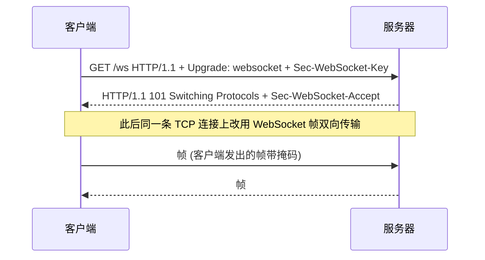

---
Title | Tools Networks Proxy Transport WebSocket
-- | --
Created @ | `2026-11-26T10:16:24Z`
Updated @| `2026-11-26T10:16:24Z`
Labels | ``
Edit @| [here](https://github.com/junxnone/linux/issues/155)

---
# WebSocket

WebSocket（WS）是一个在 HTTP 之上建立**全双工长连接**的标准协议（RFC 6455）。V2Ray/Xray 的 WebSocket 传输用标准 WebSocket 来承载代理协议的数据：外面看就是一条普通的 WebSocket 连接，所以可以被 **Nginx、Caddy、CDN 等 HTTP 服务器/网关分流和反向代理**，也可以被 VLESS 的 `fallbacks path` 分流。这是最常用的"把代理藏在一个正常网站后面"的传输方式。整体介绍见 Transport 总览。

## WebSocket 协议基础

下图展示 WebSocket 如何从一次 HTTP 请求"升级"成长连接：



图中：

- **升级握手**：客户端发一个带 `Upgrade: websocket` 和随机 `Sec-WebSocket-Key` 的 HTTP GET 请求；服务器返回 `101 Switching Protocols` 和 `Sec-WebSocket-Accept`（由客户端的 key 加固定字符串做 SHA-1 再 Base64 得到），握手完成。
- **之后**同一条 TCP 连接不再是 HTTP，而是用 **WebSocket 帧**双向传输，帧有 FIN、操作码（文本/二进制/关闭/ping/pong 等）、长度；客户端发给服务器的帧必须带掩码。
- 关键结论：握手阶段与普通 HTTP 请求一致，因此 Nginx 等可以按路径转发；握手之后是二进制帧流，代理数据就放在帧里。

## 配置

```json
{
  "streamSettings": {
    "network": "ws",
    "security": "tls",
    "wsSettings": {
      "path": "/your-random-path",
      "headers": { "Host": "example.com" },
      "maxEarlyData": 1024
    }
  }
}
```

字段含义：

字段 | 含义
-- | --
`path` | WebSocket 使用的 HTTP 路径，默认 `/`；服务端和客户端必须一致，建议使用随机、较长的路径
`headers` | 自定义 HTTP 头，如 `Host`，默认为空
`acceptProxyProtocol` | 仅入站：是否接收 PROXY protocol，用法同 TCP 传输
`maxEarlyData` | 发送"前置数据"的最大长度，用来减少建立连接的时间（v4.37.0+）：数据以 Base64 RawURLEncoding 形式附加在 path 之后，转发时需要按前缀匹配
`earlyDataHeaderName` | 设置后，前置数据放在该 HTTP 头里而不是 path 里（v4.39.0+）

表中第一列是字段，第二列是含义。另外，V2Ray 的 WebSocket 会识别 HTTP 请求里的 `X-Forwarded-For` 头来覆盖流量的来源地址，优先级高于 PROXY protocol。

## 配合 Nginx 反向代理

把 WebSocket 放在真实网站后面，Nginx 负责 TLS 和按路径分流，V2Ray 只监听本机端口：

```nginx
server {
    listen 443 ssl http2;
    server_name example.com;
    # ssl_certificate / ssl_certificate_key 略

    location /your-random-path {
        proxy_pass http://127.0.0.1:10000;
        proxy_http_version 1.1;
        proxy_set_header Upgrade $http_upgrade;
        proxy_set_header Connection "upgrade";
        proxy_set_header Host $host;
    }

    location / {
        root /var/www/html;   # 正常的网站内容
    }
}
```

要点：

- `proxy_http_version 1.1` 和 `Upgrade`、`Connection` 两个头**必须设置**，否则 WebSocket 升级失败；
- 对应的 V2Ray 入站监听 `127.0.0.1:10000`，传输选 `ws`，`path` 与 Nginx 的 `location` 一致，**入站里不用再开 TLS**（TLS 在 Nginx 终结）；
- 其他路径返回正常网站，使服务器对访问者表现为一个普通网站；
- 经 CDN 时，CDN 需要允许 WebSocket，并要注意 CDN 对长连接空闲超时的限制。

## 优缺点

优点 | 缺点
-- | --
握手就是标准 HTTP 升级，可被 Nginx/Caddy/CDN 分流和转发 | 多一层 WebSocket 帧头和 HTTP 握手，比纯 TCP 稍慢
外观是普通的 WebSocket 连接，与大量正常网站的流量一致 | 外层通常还要 TLS，"TLS 内跑 WebSocket 再跑 TLS"的流量特征可被分析
支持前置数据（early data）减少握手延迟 | 单条 TCP 连接，丢包时有队头阻塞
实现广泛，客户端支持好 | CDN 或中间网关可能对长连接有超时限制

表中左边是优点，右边是缺点。

## Reference

- [RFC 6455 - The WebSocket Protocol](https://www.rfc-editor.org/rfc/rfc6455)
- [WebSocket - V2Fly 配置文档](https://github.com/v2fly/v2fly-github-io/blob/master/docs/config/transport/websocket.md)
- [WebSocket - Xray 文档](https://github.com/XTLS/Xray-docs-next/blob/main/docs/config/transports/websocket.md)
- [Nginx - WebSocket proxying](https://nginx.org/en/docs/http/websocket.html)

