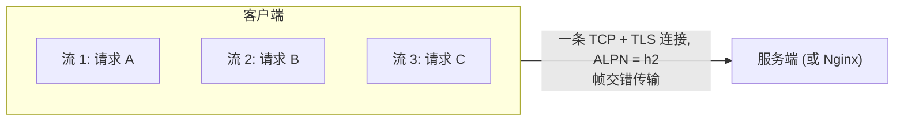

---
Title | Tools Networks Proxy Transport HTTP2
-- | --
Created @ | `2026-11-26T10:16:26Z`
Updated @| `2026-11-26T10:16:26Z`
Labels | ``
Edit @| [here](https://github.com/junxnone/linux/issues/156)

---
# HTTP2

HTTP/2 传输使用**标准的 HTTP/2 协议**承载代理数据。HTTP/2 的核心特点是在**一条 TCP 连接上并发多个流（stream）**，数据以二进制帧传输，并有头部压缩。V2Ray 3.17 起支持这种传输，它完整按 HTTP/2 标准实现，可以经过 Nginx 等 HTTP 服务器转发。按 HTTP/2 的建议，客户端和服务器必须同时开启 TLS 才能使用（浏览器的 HTTP/2 也只在 TLS 上使用）。整体介绍见 Transport 总览。

## 工作方式

下图展示 HTTP/2 如何在一条连接上复用多个流：



图中：

- 三个并发请求（流 1、2、3）被切成**帧**，在**同一条 TCP + TLS 连接**上交错发送，不需要为每个请求单独建立连接；
- 握手时通过 TLS 的 **ALPN** 扩展协商使用 `h2`；
- 关键结论：多路复用减少了握手开销；但因为整条连接建立在一条 TCP 上，TCP 层的一个丢包仍会阻塞所有流（队头阻塞），这是 HTTP/3（QUIC）要解决的问题。

## 配置

```json
{
  "streamSettings": {
    "network": "http",
    "security": "tls",
    "httpSettings": {
      "host": ["example.com"],
      "path": "/random/path",
      "method": "PUT"
    }
  }
}
```

字段含义：

字段 | 含义
-- | --
`host` | 域名数组；客户端随机选一个通信，服务端校验请求的域名是否在列表里
`path` | HTTP 路径，以 `/` 开头，客户端和服务端必须一致，默认 `/`
`method` | HTTP 方法，默认 `PUT`（v4.39.0+）
`headers` | 自定义 HTTP 头，键为名称，值为字符串数组（v4.39.0+）

表中第一列是字段，第二列是含义。V2Ray 4.20 起，服务端的 TLS 强制要求被取消：在分流部署里可以由外部网关完成 TLS，V2Ray 作为后端用明文的 **h2c**（HTTP/2 cleartext）与网关通信。

## 优缺点

优点 | 缺点
-- | --
标准 HTTP/2，可经 Nginx 等转发 | 通常必须配 TLS
多路复用，一条连接承载多个请求 | 仍是 TCP，有 TCP 队头阻塞
头部压缩，握手次数少 | 配置要求客户端和服务端的 `host`、`path` 一致，配置较复杂
外观与正常 HTTPS（h2）一致 | 新的 gRPC 传输也基于 HTTP/2，且更常被 CDN 支持，HTTP/2 传输的使用场景逐渐变少

表中左边是优点，右边是缺点。

## Reference

- [RFC 9113 - HTTP/2](https://www.rfc-editor.org/rfc/rfc9113)
- [HTTP/2 - V2Fly 配置文档](https://github.com/v2fly/v2fly-github-io/blob/master/docs/config/transport/h2.md)

