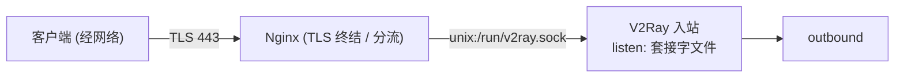

---
Title | Tools Networks Proxy Transport DomainSocket
-- | --
Created @ | `2026-11-26T10:16:35Z`
Updated @| `2026-11-26T10:16:35Z`
Labels | ``
Edit @| [here](https://github.com/junxnone/linux/issues/160)

---
# DomainSocket

Domain Socket（Unix 域套接字）是操作系统提供的**同一台机器上进程间通信**的通道，用一个文件路径来标识，数据不经过网络协议栈。V2Ray 的 DomainSocket 传输让代理的入站/出站之间用它通信：优势是使用系统内建的传输通道，不占用网络缓冲，**比本地环回网络（127.0.0.1）更快**。它只能用于支持 Unix 域套接字的平台，如 Linux 和 macOS；Windows 10 Build 17036 之前不可用。整体介绍见 Transport 总览。

## 工作方式

下图展示最典型的用法——Nginx 与 V2Ray 在同一台机器上，通过套接字文件对接：



图中：

- 外部客户端通过网络访问 Nginx；
- Nginx 不再转发到 `127.0.0.1:端口`，而是通过 **Unix 套接字文件**（如 `/run/v2ray.sock`）把请求交给 V2Ray；
- V2Ray 入站监听这个文件，再交给出站处理；
- 关键结论：本机内不走网络栈，没有端口占用，也不会被其他机器通过网络访问到，只有对该文件有权限的进程才能连接。

## 配置

```json
{
  "streamSettings": {
    "network": "domainsocket",
    "dsSettings": {
      "path": "/path/to/ds/file",
      "abstract": false,
      "padding": false
    }
  }
}
```

字段含义：

字段 | 含义
-- | --
`path` | 一个合法的文件路径；**运行 V2Ray 之前这个文件必须不存在**
`abstract` | 是否使用 abstract domain socket（Linux 特有，不对应文件系统中的文件），默认 `false`
`padding` | abstract domain socket 是否带 padding，默认 `false`（v4.28.1+）

表中第一列是字段，第二列是含义。**指定使用 domain socket 之后，入站出站代理里配置的端口和 IP 地址都会失效，所有传输由它取代。**

另外，官方文档提示（v4.32.0 起）：更推荐把套接字路径写在入站的 `listen` 处，传输方式仍然选 TCP、WebSocket 或 HTTP/2，未来这里的 DomainSocket 传输可能被弃用。

## 使用建议

- 配合 Nginx：Nginx 用 `proxy_pass http://unix:/path/to/ds/file:;`，注意 Nginx 进程对该文件的读写权限；
- 路径放在 `/run` 或 `/tmp` 下，注意重启后文件需要重新创建、或先删除旧文件；
- 套接字文件的权限决定谁能连接，应设置得足够严格；
- 只在同一台机器上有效，不能用于跨机器连接。

## 优缺点

优点 | 缺点
-- | --
比 127.0.0.1 更快，不占网络缓冲 | 只限同一台机器，只支持 Linux、macOS 等
不占用端口，不会被网络上的其他机器访问 | 文件必须事先不存在，意外退出后残留文件会导致下次启动失败
可用文件权限控制访问 | 未来可能被弃用，新版本推荐在 `listen` 处配置路径
适合 Nginx 与代理同机部署 | 配置比端口监听略复杂，排错要看文件权限

表中左边是优点，右边是缺点。

## Reference

- [DomainSocket - V2Fly 配置文档](https://github.com/v2fly/v2fly-github-io/blob/master/docs/config/transport/domainsocket.md)
- [unix(7) - Linux man page](https://man7.org/linux/man-pages/man7/unix.7.html)

