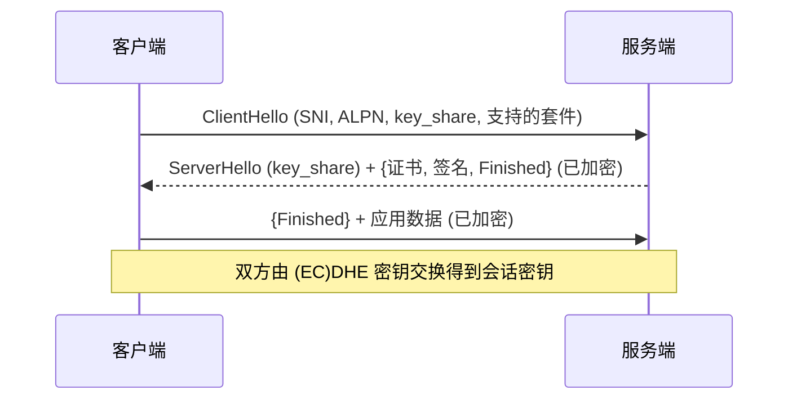

---
Title | Tools Networks Proxy Security TLS
-- | --
Created @ | `2026-11-26T10:17:43Z`
Updated @| `2026-11-26T10:17:43Z`
Labels | ``
Edit @| [here](https://github.com/junxnone/linux/issues/161)

---
# TLS

TLS（Transport Layer Security，传输层安全协议）是互联网上通用的加密传输协议，HTTPS 就是 HTTP 跑在 TLS 上。在代理里使用 TLS 有两个理由：一是给**不自带加密的协议**（如 VLESS、Trojan）提供加密和认证；二是让流量在网络上的外观与**普通 HTTPS 流量一致**。V2Ray/Xray 的 TLS 由 Go 语言标准库提供，支持 TLS 1.3，不支持 DTLS。传输层的整体结构见 Transport 总览，各协议的使用见 Protocol 系列。

## TLS 1.3 握手

下图展示 TLS 1.3 的 1-RTT 握手，以及代理里需要关注的几个字段：



图中：

- **ClientHello** 里带有：**SNI**（Server Name Indication，客户端要访问的域名，明文）、**ALPN**（应用层协议协商，如 `h2`、`http/1.1`）、`key_share`（密钥交换的公开参数）和支持的加密套件；
- **ServerHello** 返回服务端的 `key_share`，从这里开始，之后的握手消息（证书、签名、Finished）都已经加密；
- 客户端验证证书后发送 `Finished`，随即就可以发送应用数据（1 个往返）；
- 密钥交换使用 (EC)DHE，所以具有**前向保密**：长期私钥泄露不会让过去的会话被解密；
- 关键结论：握手中只有 ClientHello 里的 SNI 等少数信息是明文，所以 SNI 和 ClientHello 的"形状"（指纹）是外界识别流量的主要依据。

## 在代理里的作用

- **加密**：为 VLESS/Trojan 等本身不加密的协议提供加密；
- **身份验证**：客户端验证服务端的证书，防止中间人；
- **外观一致**：流量看起来像 HTTPS，端口通常用 443；
- **多路复用与协商**：ALPN 决定后面跑 HTTP/2 还是 HTTP/1.1（对 WebSocket 一般用 `http/1.1`，对 HTTP/2、gRPC 用 `h2`）。

## 配置

```json
{
  "streamSettings": {
    "network": "tcp",
    "security": "tls",
    "tlsSettings": {
      "serverName": "example.com",
      "alpn": ["h2", "http/1.1"],
      "certificates": [{
        "certificateFile": "/path/to/fullchain.pem",
        "keyFile": "/path/to/privkey.pem"
      }],
      "fingerprint": "chrome"
    }
  }
}
```

主要字段含义（V2Ray/Xray 版本略有差异，以所用版本文档为准）：

字段 | 含义
-- | --
`serverName` | 服务端证书的域名；客户端用它做 SNI 并校验证书，用 IP 连接时尤其需要
`alpn` | TLS 握手时声明的应用层协议，默认 `["h2", "http/1.1"]`
`certificates` | 证书列表（推荐 fullchain 证书和私钥）；服务端需要，客户端一般不需要
`minVersion` | 可接受的最小 TLS 版本，如 `1.2`
`allowInsecure` | 是否允许不安全连接（不验证证书）；**极不推荐**，新版本中已被弃用
`pinnedPeerCertSha256` | 固定对端证书的 SHA-256 指纹，用它代替 `allowInsecure` 来信任自签证书
`fingerprint` | 客户端的 TLS 指纹（模拟浏览器 ClientHello），如 `chrome`、`firefox`、`random`，基于 uTLS（Xray）
`rejectUnknownSni` | 服务端：SNI 不匹配时直接拒绝握手

表中第一列是字段，第二列是含义。注意：`allowInsecure: true` 会完全放弃对证书的验证，等于允许中间人攻击；自签证书应改用 `pinnedPeerCertSha256`。

## 证书

- 需要一个**域名**指向服务器，并申请有效证书；常用方式是 Let's Encrypt（`certbot`、`acme.sh` 等），证书约 90 天过期，需要自动续期；
- 证书里的域名要与客户端使用的 `serverName` 一致；
- 服务端 TLS 也可以放在 Nginx/Caddy 终结，V2Ray 入站只监听本机明文端口（见 WebSocket、gRPC 文章）；
- 私钥文件要设置严格的文件权限，不要提交到仓库。

## 指纹与 ECH

- **TLS 指纹**：不同软件的 ClientHello 在加密套件顺序、扩展等方面各有特征。Go 标准库的默认指纹不同于浏览器，容易被识别，Xray 的 `fingerprint` 用 uTLS 模拟 Chrome、Firefox 等浏览器的 ClientHello；
- **ECH（Encrypted Client Hello）**：把 ClientHello 里的 SNI 等敏感字段加密，减少对外暴露；Xray 提供 `echServerKeys`（服务端）和 `echConfigList`（客户端）配置。

## 优缺点

优点 | 缺点
-- | --
成熟、通用，流量外观与 HTTPS 一致 | 需要域名和有效证书，部署和续期有成本
提供加密、认证和前向保密，TLS 1.3 只需 1-RTT | 代理的 TLS 实现与浏览器的指纹不同，容易被识别（可用 `fingerprint` 缓解）
几乎所有传输（TCP、WebSocket、gRPC 等）都能搭配 | 数据被加密两次（协议加密 + TLS）时浪费 CPU，XTLS 就是针对这点优化
可由 Nginx/Caddy 终结，便于与网站共存 | 证书私钥泄露会危及所有通过它的流量

表中左边是优点，右边是缺点。无需域名和证书的替代方案是 REALITY。

## Reference

- [RFC 8446 - The Transport Layer Security (TLS) Protocol Version 1.3](https://www.rfc-editor.org/rfc/rfc8446)
- [TLS - Xray 文档](https://github.com/XTLS/Xray-docs-next/blob/main/docs/config/transports/tls.md)
- [Transport - V2Fly 配置文档](https://github.com/v2fly/v2fly-github-io/blob/master/docs/en_US/config/transport.md)
- [uTLS](https://github.com/refraction-networking/utls)
- [Let's Encrypt](https://letsencrypt.org/)

