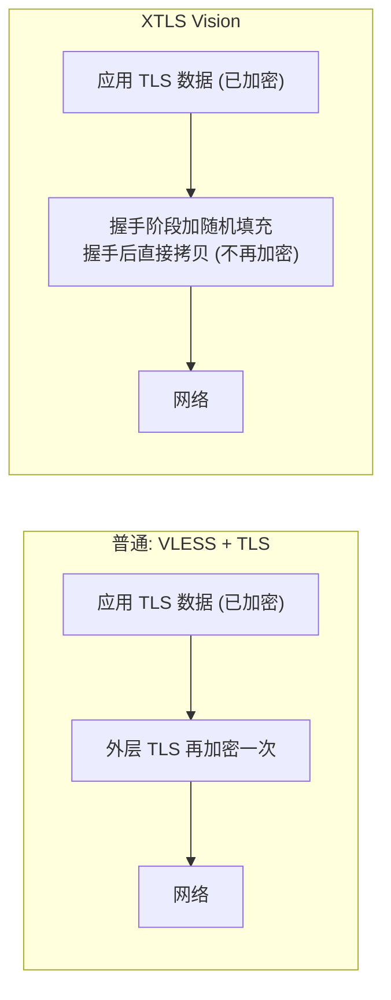

---
Title | Tools Networks Proxy Security XTLS
-- | --
Created @ | `2026-11-26T10:17:46Z`
Updated @| `2026-11-26T10:17:46Z`
Labels | ``
Edit @| [here](https://github.com/junxnone/linux/issues/162)

---
# XTLS

XTLS 是 Xray 提出的一项针对 **"TLS 内再跑 TLS"** 的优化。常见的用法是 `VLESS + TLS`：用户访问的 HTTPS 网站本身就是 TLS 加密的数据，再被代理的 TLS 包一层，等于同样的数据加密了**两次**——既浪费 CPU，又因为"外层 TLS 里面的内容也是 TLS"而留下可被分析的特征。XTLS 的做法是：对已经是 TLS 的内层数据，**不再重复加密**，而是把它直接拷贝到外层连接上。目前使用的方案叫 **XTLS Vision**，对应 VLESS 的 `flow: "xtls-rprx-vision"`。它只与 [VLESS](0143_Tools_Networks_Proxy_Protocol_VLESS) 配合使用。整体介绍见 [Proxy](0080_Tools_Networks_Proxy)。

## 工作方式

下图对比"普通 TLS 代理"和"XTLS Vision"对内层 TLS 数据的处理：



图中：

- **左边（普通方式）**：内层的 TLS 数据到达代理后，又被外层 TLS 整体加密，等于"加密 × 2"；
- **右边（Vision）**：对**内层 TLS 握手阶段**的数据包加入**随机填充**，抹平握手包的长度特征；握手完成后，内层 TLS 1.3 数据本身已经加密，**直接拷贝**到连接上，不再做第二次加密；
- 关键结论：既减少了加密开销（官方称在合适的搭配下性能明显提升），又针对"TLS in TLS"的握手特征做了处理。

## 使用条件

XTLS 只在以下搭配下可用：

- **TCP（RAW）+ TLS 或 REALITY**：此时如果内层传输的是 TLS 1.3，就会在底层直接拷贝加密后的数据；
- **VLESS Encryption**：没有底层传输限制，若底层不支持直接拷贝则只"穿透 Encryption"。

另外：

- 流控取值 `xtls-rprx-vision` 是目前的推荐写法，早期的 `xtls-rprx-direct`、`xtls-rprx-splice` 等已经不再使用；
- 只在**内层是 TLS 1.3** 的流量上才会直接拷贝（普通 HTTPS 访问大多满足）；内层不是 TLS 的流量（如明文 HTTP）仍按正常方式处理；
- 与 mKCP、WebSocket、gRPC 等传输**不能**搭配 `flow`，且**不能与 Mux 同用**（服务端和客户端都要开启 `flow` 并保持一致）。

## 配置

服务端和客户端分别在 VLESS 用户处设置 `flow`：

```json
{
  "inbounds": [{
    "protocol": "vless",
    "settings": {
      "clients": [{ "id": "5783a3e7-e373-51cd-8642-c83782b807c5", "flow": "xtls-rprx-vision" }],
      "decryption": "none"
    },
    "streamSettings": { "network": "tcp", "security": "reality" }
  }]
}
```

其中：

- `flow`：流控模式；留空或不写表示普通 TLS 代理，`xtls-rprx-vision` 表示启用 Vision；客户端的出站用户也要写同样的 `flow`；
- `security`：可以是 `tls` 或 `reality`；
- 其余字段见 VLESS、TLS、REALITY 文章。

## 优缺点

优点 | 缺点
-- | --
避免重复加密，CPU 占用和延迟更低 | 仅 Xray 支持，v2fly 的 v2ray-core 没有
针对"TLS in TLS"握手特征做了填充处理 | 只能配 VLESS，并且限于 TCP + TLS/REALITY
与 REALITY 组合是目前主流的搭配之一 | 要求内层是 TLS 1.3 才能直接拷贝，收益取决于访问内容
配置只需一个 `flow` 字段 | 实现与文档演进快，需要两端版本匹配

表中左边是优点，右边是缺点。

## Reference

- [XTLS - Xray 文档](https://github.com/XTLS/Xray-docs-next/blob/main/docs/config/features/xtls.md)
- [VLESS 入站 - Xray 文档](https://github.com/XTLS/Xray-docs-next/blob/main/docs/config/inbounds/vless.md)
- [Xray-core](https://github.com/XTLS/Xray-core)

