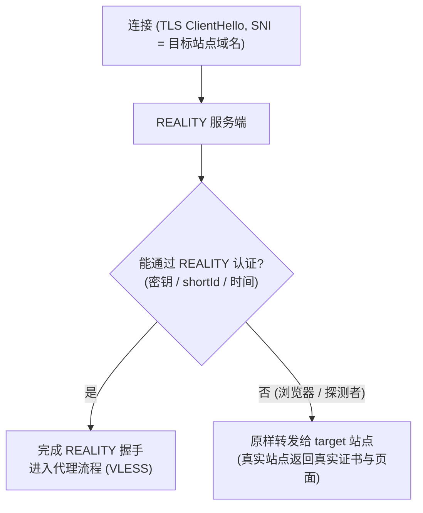

---
Title | Tools Networks Proxy Security Reality
-- | --
Created @ | `2026-11-26T10:17:48Z`
Updated @| `2026-11-26T10:17:48Z`
Labels | ``
Edit @| [here](https://github.com/junxnone/linux/issues/163)

---
# Reality

REALITY 是 Xray 对 **TLS 的一种修改**：它不需要你自己的域名和证书，而是**借用一个真实目标站点（`target`）的 TLS 握手外观**来完成握手。对外界（包括主动探测者）来说，访问你的服务器就像在访问那个目标站点；只有持有正确密钥的客户端才会被识别为代理流量。REALITY 目前仅支持与 `RAW`（TCP）、`XHTTP`、`gRPC` 三种传输组合使用，并通常与 XTLS Vision 流控配合，官方称这样可以获得数倍甚至十几倍的性能提升。整体介绍见 [Proxy](0080_Tools_Networks_Proxy)，普通 TLS 见 TLS 文章。

## 工作方式

下图展示服务端收到连接后如何区分"REALITY 客户端"与"其他访问者":



图中：

- **客户端**把 ClientHello 的 SNI 设成目标站点的域名（`serverName`），并在握手里藏入认证信息；
- **服务端**检查该握手是否来自持有正确密钥的 REALITY 客户端：认证项包括 `privateKey` 对应的公钥、`shortId` 和时间差；
- **通过认证**：服务端用 REALITY 的临时证书完成握手，之后进入正常的代理流程（通常是 VLESS）；
- **未通过认证**：服务端把流量**直接转发给 `target` 真实站点**，访问者看到的是真实站点的真实证书和内容；
- 关键结论：不需要自己的证书，外界看到的是一个真实站点的 TLS 握手，探测者无法区分"这是不是代理服务器"。

## 配置

服务端（入站）和客户端（出站）的 `realitySettings`：

```json
{
  "streamSettings": {
    "network": "tcp",
    "security": "reality",
    "realitySettings": {
      "target": "example.com:443",
      "serverNames": ["example.com"],
      "privateKey": "服务端私钥",
      "shortIds": ["0123456789abcdef"]
    }
  }
}
```

```json
{
  "streamSettings": {
    "network": "tcp",
    "security": "reality",
    "realitySettings": {
      "serverName": "example.com",
      "fingerprint": "chrome",
      "password": "服务端私钥对应的公钥",
      "shortId": "0123456789abcdef"
    }
  }
}
```

字段含义：

字段 | 端 | 含义
-- | -- | --
`target`（旧称 `dest`） | 服务端 | 必填，被借用的目标站点 `域名:端口`；格式与 VLESS 回落的 `dest` 相同；有它存在才被识别为服务端配置，**客户端不要填**
`serverNames` | 服务端 | 必填，客户端可用的 SNI 列表，不支持 `*` 通配符；一般与 `target` 的证书域名一致
`privateKey` | 服务端 | 必填，用 `xray x25519` 生成
`shortIds` | 服务端 | 必填，客户端可用的 `shortId` 列表，用来区分不同客户端
`serverName` | 客户端 | 服务端 `serverNames` 之一
`fingerprint` | 客户端 | 必填，TLS 指纹（如 `chrome`），与 TLS 文章里的同一个概念
`password` | 客户端 | 必填，服务端私钥对应的公钥（旧称 `publicKey`），用 `xray x25519 -i "服务器私钥"` 生成
`shortId` | 客户端 | 服务端 `shortIds` 之一；8 字节、16 位十六进制字符，可少于 16 位但**位数必须是偶数**，核心会在后面补 0

表中第一列是字段，第二列说明它出现在服务端还是客户端，第三列是含义。其他可选项还有 `maxTimeDiff`（允许的最大时间差，毫秒）、`mldsa65Seed`/`mldsa65Verify`（后量子签名，用 `xray mldsa65` 生成）、`limitFallbackUpload`/`limitFallbackDownload`（给转发给 target 的回落连接限速）等。

## 选择 target 的要点

- 选一个**支持 TLS 1.3 和 HTTP/2**、访问稳定、**与你服务器地理和网络位置相近**的真实站点；官方建议"偷同 ASN 的证书"；
- 可以用 `xray tls ping <域名>` 检查 target 的表现；如果 target 支持 X25519MLKEM768，REALITY 客户端会自动使用该后量子算法协商；
- **安全提醒**：鉴权失败的流量会被直接转发到 target。如果 target 用了 Cloudflare 这类 CDN，服务器就相当于给它做了端口转发，可能被扫描者利用来"偷跑流量"；可以在前面用 Nginx 过滤不符合要求的 SNI，或者配置 `limitFallbackUpload`/`limitFallbackDownload` 限速；但官方也提示限速本身是一种特征，不建议随意启用。

## 优缺点

优点 | 缺点
-- | --
不需要自己的域名和证书，省去申请和续期 | 仅 Xray 支持（v2fly 没有），且只能与 RAW、XHTTP、gRPC 搭配
握手外观与真实站点一致，主动探测得到的是真实站点的响应 | 依赖目标站点的行为，target 的变化可能影响可用性
与 XTLS Vision 配合性能好 | 服务器要能访问 target，选错 target 有被识别或被滥用的风险
客户端实现只需轻度修改 TLS 即可兼容 | 配置项多，密钥、`shortId`、`serverName` 必须严格对应

表中左边是优点，右边是缺点。

## Reference

- [REALITY - Xray 文档](https://github.com/XTLS/Xray-docs-next/blob/main/docs/config/transports/reality.md)
- [REALITY 项目](https://github.com/XTLS/REALITY)
- [Xray-core](https://github.com/XTLS/Xray-core)

