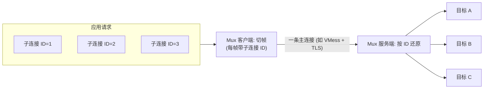

---
Title | Tools Networks Proxy V2Ray Mux
-- | --
Created @ | `2026-11-26T10:20:10Z`
Updated @| `2026-11-26T10:20:10Z`
Labels | ``
Edit @| [here](https://github.com/junxnone/linux/issues/167)

---
# Mux

Mux（多路复用，协议名 **Mux.Cool**）是 V2Ray 的一个传输层功能：它在**一条已经建立的可靠连接**里同时传输多个相互独立的"子连接"。没有 Mux 时，应用每发起一个请求，代理就要新建一条到服务器的连接（并重新握手）；开启 Mux 后，这些请求共用同一条"主连接"，省掉重复的握手。工具介绍见 [V2Ray](0066_Tools_Networks_Proxy_V2Ray)。

## 工作方式

下图展示 Mux 如何把多个子连接装进一条主连接：



图中：

- 三个子连接的数据被切成**帧（Frame）**，每帧带着对应的子连接 **ID**，在同一条主连接上交错发送；
- 服务端按 ID 还原，各自连到不同目标；
- 响应也按同样的 ID 通过主连接回来；
- 关键结论：只需要建立一条主连接就能服务多个请求，降低握手次数和延迟，但所有子连接**共享同一条底层连接**。

## 协议要点

Mux.Cool 必须运行在一个已建立的可靠数据流之上，使用**对称的**帧格式：

- **帧**：`元数据长度 L（2 字节）| 元数据（L 字节）| 额外数据（X 字节）`；
- **元数据**都包含 **ID**（子连接标识）和 **Opt**（选项，`D=0x01` 表示带有额外数据）；
- **子连接的状态**：`New`（新建，带网络类型 TCP/UDP、端口、地址类型和地址）、`Keep`（传送数据）、`End`（结束）、`KeepAlive`（保持主连接）；
- **客户端行为**：没有可用的连接时新建主连接；一个主连接可以承载若干子连接，数量由客户端决定；新子连接要先发送 `New` 再用 `Keep` 传数据，结束时发送 `End`；
- **服务端行为**：按正常连接处理收到的子连接；响应必须使用与请求相同的 ID；**服务端不能使用 `New`**。

## 配置

在**客户端出站**里开启：

```json
{
  "protocol": "vmess",
  "mux": { "enabled": true, "concurrency": 8 }
}
```

字段含义：

字段 | 含义
-- | --
`enabled` | 是否启用 Mux
`concurrency` | 一条主连接最多同时承载的子连接数，文档默认值为 8；值越大主连接越少，但单条连接的压力越大

表中第一列是字段，第二列是含义。服务端不需要特别配置，会自动识别 Mux 流量。

## 注意事项

- **不是总能提速**：Mux 适合"大量短连接"的场景（网页浏览）；对单个大文件下载、视频流这类长连接，多路复用没有收益，甚至因为所有子连接共享一个 TCP 连接，在丢包时队头阻塞会更明显。需要实测。
- **与 XTLS Vision 冲突**：使用 VLESS 的 `flow`（XTLS Vision）时不要同时开启 Mux。
- **传输层已有多路复用时没必要**：HTTP/2、gRPC、QUIC 本身就是多路复用的，再开 Mux 是重复。
- **UDP**：VLESS/VMess 的 UDP 在 Mux 上有 XUDP 等优化（Xray 提供，与 Full Cone NAT 相关），不同实现行为不同。

## 优缺点

优点 | 缺点
-- | --
减少握手次数，对大量短连接降低延迟 | 共享一条底层连接，丢包时所有子连接受影响（队头阻塞）
减少服务端的连接数 | 对长连接大流量无益，可能更慢
配置简单，只需客户端开启 | 不能与 XTLS Vision 同用；与自带多路复用的传输叠加没有意义
对只支持 TCP 的传输也能得到复用效果 | 增加了协议复杂度，调试和排错略难

表中左边是优点，右边是缺点。

## Reference

- [Mux.Cool 协议 - V2Fly 开发者文档](https://github.com/v2fly/v2fly-github-io/blob/master/docs/developer/protocols/muxcool.md)
- [XUDP: VLESS & VMess & Mux UDP FullCone NAT](https://github.com/XTLS/Xray-core/discussions/252)

