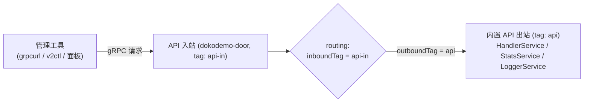

---
Title | Tools Networks Proxy V2Ray API
-- | --
Created @ | `2026-11-26T10:20:15Z`
Updated @| `2026-11-26T10:20:15Z`
Labels | ``
Edit @| [here](https://github.com/junxnone/linux/issues/169)

---
# API

V2Ray/Xray 提供一组基于 **gRPC** 的**远程控制 API**，让外部程序可以在**不重启**核心的情况下查询状态、统计流量、动态增删入站出站和用户。它主要面向高级用户和面板类软件。开启后，核心会自己建立一个以 `tag` 标识的出站代理，用户需要通过路由把所有入站的 gRPC 连接指向这个出站。工具介绍见 [V2Ray](0066_Tools_Networks_Proxy_V2Ray)，统计开关见 Policy 文章。

## 工作方式

下图展示 API 客户端如何通过 gRPC 访问核心：



图中：

- 管理工具通过 gRPC 访问一个**专用入站**（常用 dokodemo-door 监听本机一个端口，标识为 `api-in`）；
- 路由里加一条规则：来自 `api-in` 的流量，出站标识指向 `api`；
- `api` 是核心内置的出站，它实现了所选的 gRPC 服务；
- 关键结论：API 入口和普通代理入口是分开的，且要靠路由规则接到内置 API 出站上，不配这条规则 API 就不可用。

## 配置

```json
{
  "api": {
    "tag": "api",
    "services": ["HandlerService", "LoggerService", "StatsService"]
  },
  "inbounds": [{
    "tag": "api-in",
    "port": 10085,
    "listen": "127.0.0.1",
    "protocol": "dokodemo-door",
    "settings": { "address": "127.0.0.1" }
  }],
  "routing": {
    "rules": [{ "type": "field", "inboundTag": ["api-in"], "outboundTag": "api" }]
  }
}
```

字段含义：

字段 | 含义
-- | --
`api.tag` | 内置 API 出站的标识，路由规则的 `outboundTag` 要与它一致
`api.services` | 启用的 API 服务列表
`inbounds[].tag` / `port` | 专用入站的标识和端口，**务必只监听本机回环地址**
路由规则 | 把专用入站的流量指向 API 出站

表中第一列是字段，第二列是含义。

## 可用的服务

服务 | 作用
-- | --
`HandlerService` | 修改入站出站：新增/删除入站、出站；给入站添加/删除用户（仅支持 VMess、VLESS、Trojan）
`LoggerService` | 重启内置的日志，可配合 logrotate 做日志文件处理
`StatsService` | 内置的数据统计服务，查询入站/出站/用户的上下行流量（需在 Policy 里开启统计，并配置 `stats`）
`ObservatoryService` | 连接观测器 API（v4.38.0+），用于获取出站的连通性/延迟

表中第一列是服务名，第二列是作用。

## 使用示例

查询用户流量的思路（需要先在 Policy 里启用 `statsUserUplink`/`statsUserDownlink` 并给用户设置 `email`）：

```bash
# 用 grpcurl 直接调用 StatsService (示意)
grpcurl -plaintext -d '{"name":"user>>>love@example.com>>>traffic>>>uplink","reset":false}' \
  127.0.0.1:10085 v2ray.core.app.stats.command.StatsService/GetStats
```

其中统计项的名称形如 `user>>>邮箱>>>traffic>>>uplink`（或 `downlink`）；`reset` 为 `true` 时读取后清零。服务名和方法名因版本而异（Xray 使用 `xray.app.stats.command.StatsService`），以所用版本的文档为准。

## 使用须知

- API **没有认证**，必须只监听 `127.0.0.1` 或通过防火墙限制访问，**不要暴露到公网**；
- 能调用 `HandlerService` 的人可以添加/删除入站和用户，等同于完全控制代理；
- 动态添加的入站、用户在核心重启后不会保留，需要同步写入配置文件。

## 优缺点

优点 | 缺点
-- | --
不重启核心就能管理入站出站和用户 | 没有认证，配置不当会带来安全风险
可以获取流量统计，适合做面板和计费 | 需要配套的路由和专用入站，配置易遗漏
基于标准的 gRPC，各语言都能调用 | 服务名、字段随版本（v2fly 与 Xray）不同
HandlerService 仅支持 VMess、VLESS、Trojan 的用户管理 | 统计需先在 Policy 里启用，没有历史数据

表中左边是优点，右边是缺点。

## Reference

- [API - V2Fly 配置文档](https://github.com/v2fly/v2fly-github-io/blob/master/docs/en_US/config/api.md)
- [gRPC](https://grpc.io/)

