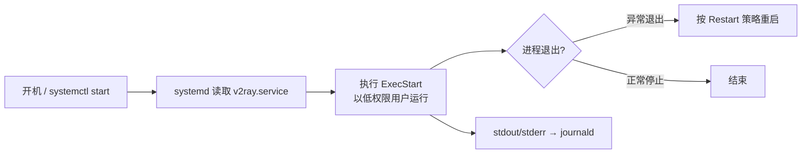

---
Title | Tools Networks Proxy V2Ray Systemd
-- | --
Created @ | `2026-11-26T10:22:19Z`
Updated @| `2026-11-26T10:22:19Z`
Labels | ``
Edit @| [here](https://github.com/junxnone/linux/issues/171)

---
# Systemd

在 Linux 服务器上，V2Ray/Xray 通常作为 **systemd 服务**长期运行：开机自启、崩溃自动重启、用 `journalctl` 看日志。本文说明服务单元文件怎么写、权限怎么给、怎么管理和排错。工具介绍见 [V2Ray](0066_Tools_Networks_Proxy_V2Ray)，使用 Docker 方式见同文。

## 工作方式

下图展示 systemd 如何管理代理进程：



图中：

- systemd 读取服务单元文件后，按 `ExecStart` 启动代理进程，并以指定的低权限用户运行；
- 进程异常退出时，按 `Restart` 策略自动重启（但不重启配置错误等明确的退出码）；
- 进程的标准输出和错误输出被 **journald** 收集，用 `journalctl` 查看；
- 关键结论：systemd 负责"让它一直在运行"，配置错了（退出码 23）就不会无限重启。

## 单元文件

常见的 `/etc/systemd/system/v2ray.service`（路径以安装位置为准，以官方安装脚本生成的为准）：

```ini
[Unit]
Description=V2Ray Service
Documentation=https://www.v2fly.org/
After=network.target nss-lookup.target

[Service]
User=nobody
CapabilityBoundingSet=CAP_NET_ADMIN CAP_NET_BIND_SERVICE
AmbientCapabilities=CAP_NET_ADMIN CAP_NET_BIND_SERVICE
NoNewPrivileges=true
ExecStart=/usr/local/bin/v2ray run -config /usr/local/etc/v2ray/config.json
Restart=on-failure
RestartPreventExitStatus=23
LimitNPROC=500
LimitNOFILE=1000000

[Install]
WantedBy=multi-user.target
```

各项含义：

项 | 含义
-- | --
`After=network.target nss-lookup.target` | 等网络和域名解析就绪后再启动
`User=nobody` | 用低权限用户运行，降低被攻破后的影响
`CapabilityBoundingSet` / `AmbientCapabilities` | 授予必要的能力：`CAP_NET_BIND_SERVICE` 允许绑定 1024 以下的端口（如 443），`CAP_NET_ADMIN` 用于透明代理里设置 socket 选项
`NoNewPrivileges=true` | 禁止进程获得新的特权
`ExecStart` | 启动命令；**命令行参数因版本而异**（v4 用 `v2ray -config ...`，v5 用 `v2ray run -c ...`，Xray 用 `xray run -c ...`）
`Restart=on-failure` | 非正常退出时自动重启
`RestartPreventExitStatus=23` | 退出码 23（常表示配置错误）不重启，避免无限重启循环
`LimitNOFILE` / `LimitNPROC` | 提高文件描述符和进程数上限，适合高并发

表中第一列是配置项，第二列是含义。

## 常用命令

```bash
sudo systemctl daemon-reload            # 改了单元文件后重新加载
sudo systemctl enable --now v2ray       # 开机自启并立即启动
sudo systemctl status v2ray             # 查看状态
sudo systemctl restart v2ray            # 改配置后重启
sudo journalctl -u v2ray -f             # 实时看日志
sudo journalctl -u v2ray --since "1 hour ago"   # 查看最近一小时日志
```

其中 `-u v2ray` 指定服务名，`-f` 表示持续输出新日志。启动前先检查配置语法，不同版本命令不同，例如 `v2ray test -c config.json`（v5）或 `v2ray -test -config config.json`（v4），Xray 是 `xray run -test -c config.json`，以所用版本为准。

## 配置文件与日志

- 配置文件放在固定路径（如 `/usr/local/etc/v2ray/config.json`），权限设为 `640` 或更严，属主与运行用户一致，避免私钥或 UUID 被其他用户读取；
- 日志在配置里 `log` 段设置：`loglevel`（debug/info/warning/error/none）和 `access`、`error` 文件路径；用文件日志时注意目录要有写权限，并配合 logrotate 轮转；
- 调试时临时把 `loglevel` 设为 `debug`，排完错改回 `warning`，日志太多会占用磁盘并泄露访问记录。

## 排错

- `systemctl status` 显示 `failed`：用 `journalctl -u v2ray -e` 看最后的错误；
- 端口绑定失败（`permission denied`）：绑定 443 等低端口需要 `CAP_NET_BIND_SERVICE`，或者改用 1024 以上端口；
- 端口被占用：`ss -lntp | grep :443` 找占用者；
- 配置错误退出（退出码 23）：先用上面的测试命令检查，不会被自动重启；
- 以 `nobody` 运行读不到证书或日志目录：检查文件权限和属主。

## 优缺点

优点 | 缺点
-- | --
开机自启，崩溃自动恢复 | 单元文件的命令行参数随版本不同，升级后可能失效
日志统一进 journald，方便查看和检索 | 日志默认可能保留较长时间，需要关注隐私和磁盘
能用 systemd 的沙箱选项提高安全性 | 对不熟悉 systemd 的用户有一定学习成本
可配合依赖关系（如等待网络） | 容器环境里常用 Docker/Compose 的重启策略替代

表中左边是优点，右边是缺点。

## Reference

- [systemd.service(5)](https://www.freedesktop.org/software/systemd/man/latest/systemd.service.html)
- [fhs-install-v2ray - Github](https://github.com/v2fly/fhs-install-v2ray)
- [journalctl(1)](https://www.freedesktop.org/software/systemd/man/latest/journalctl.html)

