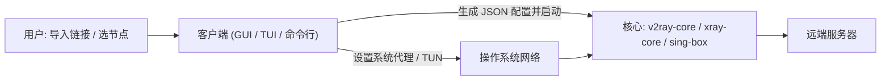

---
Title | Tools Networks Proxy V2Ray Client
-- | --
Created @ | `2026-11-26T10:22:23Z`
Updated @| `2026-11-26T10:22:23Z`
Labels | ``
Edit @| [here](https://github.com/junxnone/linux/issues/173)

---
# Client

V2Ray/Xray 的**核心程序**（v2ray-core、xray-core）是命令行程序，只读 JSON 配置。日常使用时，大多数人会用在核心之上封装的**客户端**：它们帮你管理节点、一键导入分享链接、设置系统代理、切换分流规则。本文介绍客户端的类型、核心与客户端的关系，以及常见的分享链接格式。工具介绍见 [V2Ray](0066_Tools_Networks_Proxy_V2Ray)，Linux 上的服务化部署见 Systemd 文章。

## 客户端与核心的关系

下图展示客户端、核心和系统代理的关系：

图中：

- 用户在客户端里导入节点（分享链接、订阅），选择当前使用的节点和分流模式；
- 客户端根据选择**生成核心的 JSON 配置**并启动核心进程；
- 同时，客户端把**系统代理**（或 TUN 虚拟网卡）指向核心的本地入站，让应用的流量进入核心；
- 核心再按路由规则分流并连接远端服务器；
- 关键结论：不同客户端只是"管理层"，真正做代理的是核心，所以协议支持取决于所带核心的版本。

## 客户端类型

下表按平台列出常见的几类客户端（项目更新活跃度变化很快，选用前请先看项目仓库近期是否仍在维护）：

平台 | 类型 | 说明
-- | -- | --
Linux/服务器 | 核心命令行（v2ray、xray、sing-box） | 最基础，直接写 JSON 配置，配合 systemd 运行（见 Systemd 文章）
Linux 桌面 | Web 管理界面（如 v2rayA）、桌面 GUI | 提供节点管理和透明代理开关，适合不想手写配置的用户
Windows | 桌面 GUI（如 v2rayN） | 图形界面，支持系统代理、订阅和多种核心
macOS | 桌面 GUI（如 V2RayXS、Clash 系客户端） | 与系统代理/TUN 集成
Android | 移动客户端（如 v2rayNG） | 用 VpnService 把全部流量接入核心
iOS | 商店客户端（如 Shadowrocket、Streisand 等） | 受平台限制，通常要从应用商店获取，部分需付费

表中第一列是平台，第二列是客户端类型和代表，第三列是说明。这里只是示例，不构成推荐，也不保证各项目的现状。

## 订阅与分享链接

客户端通常支持用**分享链接**导入单个节点，或用**订阅地址**批量导入。几种常见链接格式（社区约定，不同客户端的支持范围不同）：

协议 | 链接格式示例
-- | --
VMess | `vmess://` + Base64(JSON)，JSON 里包含地址、端口、UUID、传输和 TLS 等字段（也有 VMessAEAD 的新格式提案）
VLESS | `vless://UUID@host:port?type=ws&security=tls&path=%2Fws&sni=example.com#备注`
Shadowsocks | `ss://` + Base64(`method:password`) + `@host:port#备注`（SIP002）
Trojan | `trojan://密码@host:port?sni=example.com#备注`

表中第一列是协议，第二列是链接格式。其中 `?` 之后是用 `&` 分隔的参数（传输方式、安全层、路径、SNI 等），`#` 之后是节点备注。**分享链接里包含 UUID 或密码，等同于账号凭据**，不要公开发布，也不要把含凭据的订阅地址提交到仓库。

## 选择与使用建议

- **协议支持**：确认客户端内置核心的版本是否支持你用的协议（如 VLESS Vision、REALITY 需要 Xray 核心；Hysteria、TUIC 需要 sing-box 或对应核心）；
- **分流**：客户端通常带有"全局/规则/直连"模式和规则集，实质是核心的路由配置，见 Routing 文章；
- **TUN 模式**：用虚拟网卡接管整机流量，比系统代理覆盖更全，但需要管理员权限；
- **订阅更新**：订阅地址是节点的来源，更新前要信任订阅提供方，因为它决定了你的流量走向；
- **安全**：只从项目官方渠道下载，校验发布页给出的校验和，不要使用来路不明的"修改版"。

## 优缺点

优点 | 缺点
-- | --
不用手写 JSON，导入链接即可使用 | 项目更新活跃度参差不齐，部分停止维护
内置系统代理、分流、订阅管理 | 客户端内置核心版本落后时，新协议不可用
图形界面便于切换节点和排错 | 订阅和第三方客户端引入额外的信任关系
跨平台选择多 | 各客户端的行为、配置格式不统一，排错要对照核心日志

表中左边是优点，右边是缺点。

## 使用须知

- 只在符合所在网络管理规定和当地法律法规的前提下使用。
- 不要使用来源不明的订阅和客户端，它们可能收集你的流量或凭据。

## Reference

- [VMessAEAD / VLESS Sharing Link Standard Proposal](https://github.com/XTLS/Xray-core/issues/91)
- [SIP002 - URI Scheme](https://github.com/shadowsocks/shadowsocks-org/blob/main/docs/doc/sip002.md)
- [v2fly/v2ray-core](https://github.com/v2fly/v2ray-core)
- [XTLS/Xray-core](https://github.com/XTLS/Xray-core)
- [SagerNet/sing-box](https://github.com/SagerNet/sing-box)

