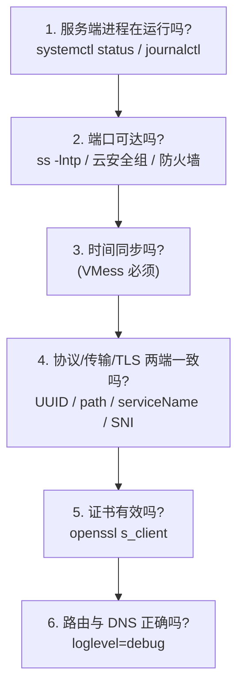

---
Title | Tools Networks Proxy V2Ray Troubleshooting
-- | --
Created @ | `2026-11-26T10:22:25Z`
Updated @| `2026-11-26T10:22:25Z`
Labels | ``
Edit @| [here](https://github.com/junxnone/linux/issues/174)

---
# Troubleshooting

代理连不上、速度慢或者"有时能用有时不能用"，原因通常集中在几个方面：时间、配置对不上、端口和防火墙、证书、DNS、路径和反向代理。本文给出一条**从外到内**的排查路线和常见日志的含义。工具介绍见 [V2Ray](0066_Tools_Networks_Proxy_V2Ray)，通用的代理排错见 [Proxy](0080_Tools_Networks_Proxy)。

## 排查路线

下图把常见问题按"从底层到上层"的顺序排列，逐层检查可以快速定位：



图中：

- 从上到下是**由底层到上层**：先确认进程、端口、网络通不通，再检查时间、配置一致性、证书，最后看路由和 DNS；
- 每一步的失败现象不同：前两步通常是"连接超时/被拒绝"，第 3、4 步是"连接成功但被服务端拒绝"，第 5 步是"证书错误"，第 6 步是"能连但访问某些站点不通"；
- 关键结论：先分清是**连不上**、**连上了被拒**还是**连上了但访问有问题**，再选对应的排查方法。

## 逐项检查

**1. 进程和日志**

```bash
sudo systemctl status v2ray
sudo journalctl -u v2ray -e          # 看最后的错误
```

把 `loglevel` 临时设为 `debug`（排完改回 `warning`），可看到更详细的连接、路由、DNS 信息。

**2. 端口与防火墙**

```bash
ss -lntp | grep 443                  # 服务端是否在监听
nc -vz server.example.com 443        # 客户端到服务端的 TCP 连通性
```

要检查：云厂商的**安全组**、主机防火墙（ufw、firewalld、iptables）是否放行；UDP 传输（mKCP、QUIC、Hysteria）要放行的是 **UDP** 端口。

**3. 系统时间**

VMess 要求客户端与服务端的 UTC 时间误差在 90 秒内。用 `date -u` 对比两端时间，不同步就安装 `chrony`/`ntp` 同步。VLESS、Trojan、Shadowsocks（非 2022 版）不依赖时间；Shadowsocks 2022 要求误差不超过 30 秒。

**4. 两端配置一致**

要一致的项：协议和用户 ID（UUID/密码）、传输方式、`path`（WebSocket）、`serviceName`（gRPC）、`host`、`security`（TLS/REALITY）、`serverName`/SNI、`flow`、mKCP 的参数和 `seed`、QUIC 的 `security`/`key`。

**5. 证书**

```bash
openssl s_client -connect server.example.com:443 -servername server.example.com </dev/null 2>/dev/null | openssl x509 -noout -dates -subject
```

检查证书是否过期、域名是否与 `serverName` 一致；自动续期后记得重载服务。

**6. 路由与 DNS**

访问某些站点不通时，在 debug 日志里看该域名被分到了哪个出站、DNS 解析成了什么 IP；常见问题是 `geosite`/`geoip` 数据文件过旧，或 `domainStrategy` 导致解析方式不对（见 Routing、DNS 文章）。

## 常见日志与含义

日志特征 | 含义和处理
-- | --
`invalid user` / `rejected ... invalid user` | UUID 不匹配，或 **VMess 时间偏差过大**；对时、核对 UUID
`failed to read request header: EOF` / `unexpected EOF` | 对端不是预期协议的客户端（探测、端口扫描、协议或传输不一致）；或连接在握手时被中断
`tls: failed to verify certificate` / `x509: certificate ...` | 证书过期、域名不匹配或被中间人替换；核对 `serverName` 和证书
`dial tcp ...: connect: connection refused` | 对端没有监听该端口，或防火墙拒绝；检查服务和端口
`i/o timeout` / `context deadline exceeded` | 网络不通或被丢包；检查路由、安全组、网络质量
`no such host` / `lookup ... failed` | DNS 解析失败；检查 DNS 配置和是否能访问解析服务器
`bind: address already in use` | 端口被占用；`ss -lntp` 找占用者
`bind: permission denied` | 绑定低端口没有权限；授予 `CAP_NET_BIND_SERVICE` 或改端口
WebSocket 客户端报 `bad status 400/404` | `path` 对不上，或反向代理（Nginx）没配好 WebSocket 升级头
`502 Bad Gateway`（经 Nginx 时） | Nginx 到后端不通：后端没启动、端口写错、协议（`grpc://` 与 `http://`）不一致

表中第一列是日志特征（不同版本措辞会略有差异），第二列是含义和处理办法。

## 速度慢

- **用 `curl` 测试**：`curl -x socks5h://127.0.0.1:1080 -o /dev/null -w "%{time_connect} %{time_starttransfer} %{speed_download}\n" https://example.com`，分别看连接时间、首字节时间、下载速度；
- **看丢包和延迟**：`ping`、`mtr` 到服务器，丢包高时可考虑 mKCP、QUIC 等 UDP 传输（见 Transport 文章），或更换线路；
- **服务端 CPU**：双重加密（TLS + 协议加密）占 CPU，用 XTLS Vision 可以缓解；
- **拥塞控制**：服务端可启用 BBR（`sysctl net.ipv4.tcp_congestion_control=bbr`，需要内核支持）改善高延迟链路；
- **MTU 问题**：某些网络上大包被丢弃，表现为握手成功但大页面卡住，可尝试调低 MTU；
- **Mux**：对大文件下载未必有益，见 Mux 文章。

## 使用须知

- 提交问题或贴日志前，先把 UUID、密码、域名、IP 等敏感信息替换掉；
- 只在符合所在网络管理规定和当地法律法规的前提下使用。

## Reference

- [V2Fly 文档站](https://www.v2fly.org/)
- [Xray 文档站](https://xtls.github.io/)
- [BBR - Google](https://github.com/google/bbr)
- [mtr(8)](https://linux.die.net/man/8/mtr)

