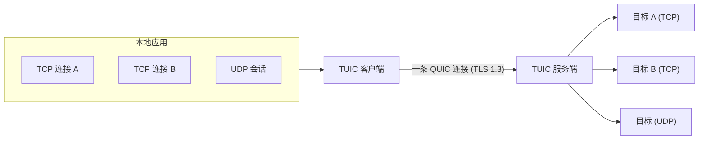

---
Title | Tools Networks Proxy TUIC
-- | --
Created @ | `2026-11-26T10:25:52Z`
Updated @| `2026-11-26T10:25:52Z`
Labels | ``
Edit @| [here](https://github.com/junxnone/linux/issues/179)

---
# TUIC

TUIC 是一个基于 **QUIC** 的**标准化代理协议**，用来中继 TCP 和 UDP 流量。它的项目仓库（tuic-protocol/tuic）只维护**协议规范**，并没有官方实现——原因是把精力放在协议设计本身，避免重复其他实现里已经成熟的功能；实际使用的是第三方实现（如 sing-box、mihomo 等）。当前最新的协议版本是 `0x05`，不同协议版本之间不保证兼容。总览见 [Proxy](0080_Tools_Networks_Proxy)，QUIC 的基础见 QUIC 文章，同类协议见 Hysteria 文章。

## 设计目标

TUIC 的出发点（项目 README 中列出）：

- 用 **0-RTT** 代理 TCP 和 UDP 流量；
- 对 UDP 代理实现 **Full Cone NAT** 兼容（外部任何主机都可以通过映射端口向内部发包，这对游戏、P2P、语音很重要）；
- 同时支持**有损**（数据报）和**无损**（流）两种 UDP 代理方式；
- 利用 QUIC 的优势：内置安全传输和可靠传输、双向的用户态拥塞控制、流的多路复用、连接迁移；
- 优先考虑**简单、灵活、可扩展**。

## 工作方式

下图展示 TUIC 在一条 QUIC 连接上承载 TCP 和 UDP 的方式：

图中：

- 本地应用的多个 TCP 连接和 UDP 会话，由 TUIC 客户端汇聚到**同一条 QUIC 连接**上；
- 每个 TCP 连接对应一个 QUIC **流**，利用 QUIC 的多路复用，一个流的丢包不会阻塞其他流（没有 TCP 队头阻塞）；
- UDP 既可以用 QUIC 的**不可靠数据报**（延迟低，可能丢包）传输，也可以用**流**传输（可靠，延迟稍高）；
- 服务端再分别连接各个目标；
- 关键结论：所有流量复用一条 QUIC 连接，认证和加密由 QUIC/TLS 1.3 提供，TUIC 本身只负责定义"如何请求代理目标"的消息格式。

## 实现与支持

README 里列出了第三方实现（按名称排序，下面只列部分代表）：

角色 | 实现
-- | --
服务端 | mihomo、sing-box、shoes、Itsusinn/tuic
客户端 | mihomo、sing-box、ClashRS、dae（Linux）、tuic (Itsusinn/tuic)、以及 Shadowrocket、Surge、Stash、Egern 等 Apple 平台的闭源软件

表中第一列是角色，第二列是支持的实现；完整列表见项目 README。使用时通常是在 sing-box 或 mihomo 的配置里添加一个 `tuic` 类型的出站/入站，配置字段以所用内核文档为准。

## 与 Hysteria 的对比

对比项 | TUIC | Hysteria 2
-- | -- | --
底层 | QUIC | QUIC + HTTP/3 伪装
定位 | 标准化的**协议规范**，实现由第三方提供 | 协议 + 官方实现（客户端和服务端）
UDP | 数据报（有损）和流（无损）两种，支持 Full Cone NAT | 数据报
带宽控制 | 依赖 QUIC 拥塞控制（可选算法） | 可在客户端指定带宽，按设定的速率发送
外观 | 标准 QUIC | 伪装成 HTTP/3 站点
版本 | 协议 0x05，版本间不兼容 | 2.0.0 起的协议，与 1.x 不兼容

表中第一列是对比项，后两列是两个协议的情况。选择建议：需要 Full Cone NAT 的 UDP（游戏、语音）或者想用 sing-box/mihomo 统一管理时可选 TUIC；追求在丢包网络上跑满带宽、需要抗主动探测时选 Hysteria 2。

## 优缺点

优点 | 缺点
-- | --
0-RTT，复用 QUIC 的多路复用和连接迁移 | 基于 UDP，在限制 UDP 的网络里不可用
Full Cone NAT 兼容，UDP 有数据报和流两种模式 | 没有官方实现，实现质量和功能因软件而异
协议规范公开，实现可互换 | 协议版本间不兼容，客户端和服务端版本需匹配
协议简单，易于集成到通用平台 | 外观是 QUIC 而非 HTTP/3 站点，没有 Hysteria 那样的 Web 伪装机制

表中左边是优点，右边是缺点。

## Reference

- [tuic-protocol/tuic](https://github.com/tuic-protocol/tuic)
- [TUIC 协议规范 SPEC.md](https://github.com/tuic-protocol/tuic/blob/master/SPEC.md)
- [RFC 9000 - QUIC](https://www.rfc-editor.org/rfc/rfc9000)

