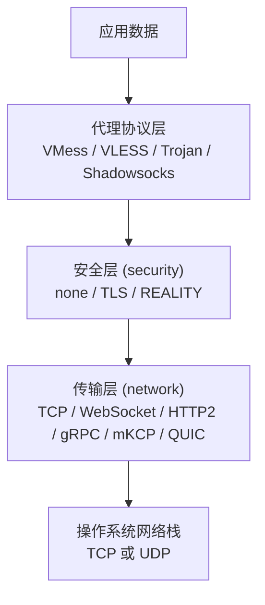

---
Title | Tools Networks Proxy Transport
-- | --
Created @ | `2026-11-26T10:26:34Z`
Updated @| `2026-11-26T10:26:34Z`
Labels | ``
Edit @| [here](https://github.com/junxnone/linux/issues/181)

---
# Transport

在 V2Ray/Xray 里，**传输（transport）**指的是当前节点与其他节点之间"线上"如何传递数据：代理协议（VMess、VLESS 等）只描述"请求是什么"，而传输层决定"这些字节通过什么方式发出去"。这种拆分让协议和传输可以自由组合——同一个 VLESS，可以跑在 TCP 上，也可以跑在 WebSocket、gRPC 或 mKCP 上。两端的传输方式必须一致。总览见 [Proxy](0080_Tools_Networks_Proxy)，协议部分见 [Protocol 总览](0080_Tools_Networks_Proxy)，工具本身见 [V2Ray](0066_Tools_Networks_Proxy_V2Ray)。

## 分层模型

下图展示一条代理连接从应用到网络各层的结构，以及"协议、传输、安全"三个可替换的层：



图中：

- 最上层是**代理协议**：负责认证和说明目标地址，见各协议文章；
- 中间的**安全层**（配置里的 `security`）决定是否再加一层传输加密，取值常见有 `none`、`tls`，Xray 还有 `reality`；
- 下面的**传输层**（配置里的 `network`）决定数据的承载方式：`tcp`、`ws`（WebSocket）、`http`（HTTP/2）、`grpc`、`kcp`（mKCP）、`quic`、`domainsocket`；
- 最底下是操作系统的 TCP 或 UDP。
- 关键结论：这三层在配置里是独立选项，组合有约束（例如 HTTP/2 和 gRPC 要求 TLS，mKCP 和 QUIC 基于 UDP），选好后**客户端和服务端必须完全一致**。

## 配置结构

每个入站和出站都有一个 `streamSettings`，用来配置传输：

```json
{
  "streamSettings": {
    "network": "ws",
    "security": "tls",
    "tlsSettings": { "serverName": "example.com" },
    "wsSettings": { "path": "/ws" }
  }
}
```

主要字段含义：

字段 | 含义
-- | --
`network` | 传输方式：`tcp`、`kcp`、`ws`、`http`、`domainsocket`、`quic`、`grpc` 等，默认 `tcp`
`security` | 传输层加密：`none`（默认）、`tls`，Xray 还有 `reality`
`tlsSettings` | TLS 配置：`serverName`、`alpn`、`certificates` 等
`tcpSettings` / `wsSettings` / `kcpSettings` ... | 对应传输方式自己的参数，只在使用该传输时有效
`sockopt` | 套接字选项：`mark`、`tcpFastOpen`、`tproxy` 等，用于透明代理

表中第一列是字段，第二列是含义。全局的 `transport` 字段可以给所有连接设置默认的传输参数，每个连接的 `streamSettings` 可以单独覆盖。

## 传输方式对比

传输 | 底层 | 是否需要 TLS | 特点
-- | -- | -- | --
TCP | TCP | 可选 | 默认，最简单、最稳定，可配合 TLS；可选 HTTP 头部伪装
WebSocket | TCP (HTTP 升级) | 可选，通常配 TLS | 可被 Nginx/CDN 反向代理和分流，最常用的"伪装成网站"方式
HTTP/2 | TCP | 要求 TLS（也可用明文 h2c 由网关终结 TLS） | 多路复用，可被 HTTP 服务器转发
gRPC | TCP (HTTP/2) | 通常配 TLS | 基于 HTTP/2，自带多路复用，可经 CDN
mKCP | UDP | 否 | 用 UDP 模拟 TCP，牺牲带宽换低延迟，适合高丢包网络
QUIC | UDP | 强制（内置 TLS 1.3） | 1-RTT/0-RTT 握手，多路复用无队头阻塞，支持连接迁移
DomainSocket | Unix 套接字 | 否 | 本机进程间通信，不占用网络缓存，仅限 Linux/macOS

表中第一列是传输方式，第二列是实际承载的底层，第三列是对 TLS 的要求，第四列是特点。选择建议：没有特殊需求用 **TCP + TLS**（或 VLESS + REALITY）；需要经过 Nginx 或 CDN 时用 **WebSocket** 或 **gRPC**；网络丢包严重、能接受额外流量时才考虑 **mKCP**；同机进程间转发用 **DomainSocket**。

## 相关文章

传输方式各有专属文章：

- [TCP](0154_Tools_Networks_Proxy_Transport_TCP)
- [WebSocket](0155_Tools_Networks_Proxy_Transport_WebSocket)
- [HTTP2](0156_Tools_Networks_Proxy_Transport_HTTP2)
- [gRPC](0157_Tools_Networks_Proxy_Transport_gRPC)
- [mKCP](0158_Tools_Networks_Proxy_Transport_mKCP)
- [QUIC](0159_Tools_Networks_Proxy_Transport_QUIC)
- [DomainSocket](0160_Tools_Networks_Proxy_Transport_DomainSocket)

安全层的专属文章：

- [TLS](0161_Tools_Networks_Proxy_Security_TLS)
- [XTLS](0162_Tools_Networks_Proxy_Security_XTLS)
- [Reality](0163_Tools_Networks_Proxy_Security_Reality)

Xray 还引入了 XHTTP、HTTPUpgrade 等新传输，见其官方文档。
## Reference

- [Transport - V2Fly 配置文档](https://github.com/v2fly/v2fly-github-io/blob/master/docs/en_US/config/transport.md)
- [Transport - Xray 文档](https://github.com/XTLS/Xray-docs-next/blob/main/docs/config/transport.md)

